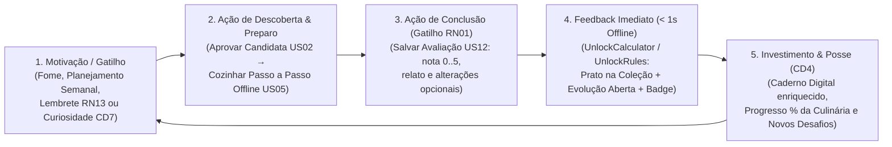
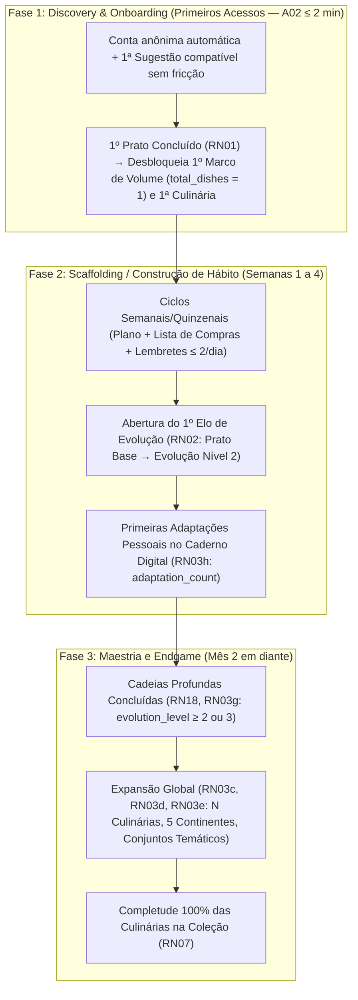
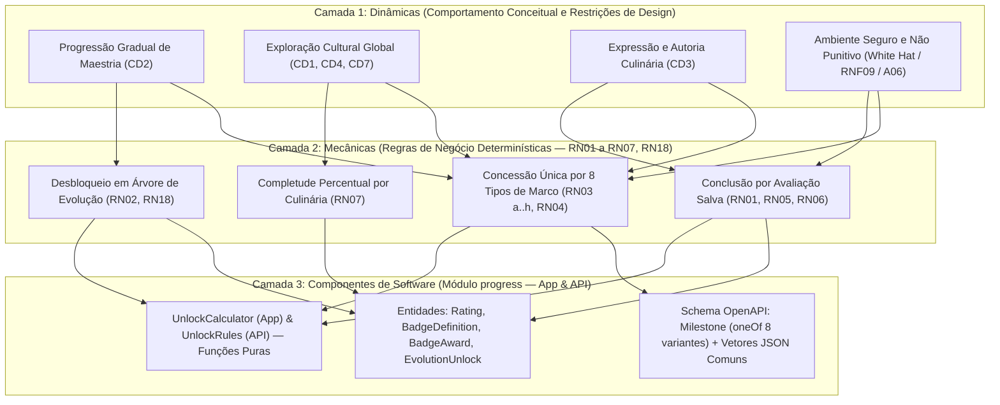

# Modelagem Conceitual de Gamificação — Framework Híbrido 6D + Octalysis (Panelada)

> **Fase Transversal (Requisitos & Arquitetura) — Fundamentação Metodológica de Gamificação.**
> **Destino:** `/docs/fase2/framework-gamificacao.md`. **Versão:** 1.0 — 18/11/2026 — **Status:** Aprovado pela dupla.
> **Insumos:** `personas.md`, `requisitos.md`, `backlog.md`, `regras-de-negocio.md`, `modelo-conceitual.md`, `atributos-qualidade.md`, `diagrama-classes.md`, `padroes-de-projeto.md`, `sequencia-uc10.md`, `openapi.yaml` e `ADR-016`.
> **Convenção Bilíngue ([ADR-015](./adr/adr-015-idioma-dos-identificadores.md)):** conceitos metodológicos, dinâmicas e regras de negócio em português (Brasil); identificadores de classes, métodos e tipos do contrato (`UnlockCalculator`, `UnlockRules`, `Milestone`, `BadgeDefinition`) em inglês.

---

## 1. Visão Geral e Escolha Metodológica ([ADR-016](./adr/adr-016-framework-conceitual-gamificacao.md))

Para atender à exigência de estruturar a gamificação do **Panelada** sobre um referencial teórico consolidado, avaliamos cinco frameworks da literatura (*6D Framework*, *Octalysis*, *MDA*, *Hexad User Types* e *Self-Determination Theory*).

### 1.1. Comparativo dos Frameworks Levantados

| Framework | Referência Principal | Foco Central | Pontos Fortes para o Panelada | Limitações se Usado Isoladamente |
|---|---|---|---|---|
| **6D Framework** | Werbach & Hunter (2012) — *For the Win* | **Engenharia e Processo de Design de Sistemas Gamificados** | Estrutura em 6 etapas (**D1–D6**), modela formalmente ciclos de engajamento/progressão (**D4**) e decompõe o sistema na **Pirâmide DMC** (Dinâmicas, Mecânicas e Componentes — **D6**), conectando requisitos diretamente às classes de software. | Vocabulário psicológico menos granular para explicar por que mecânicas punitivas (*streaks* perdidos) devem ser evitadas na culinária doméstica. |
| **Octalysis** | Yu-kai Chou (2015) — *Actionable Gamification* | **Psicologia Motivacional e Design Centrado no Humano** | Mapeia os **8 Core Drives (CD1–CD8)**, diferencia motivação **White Hat** (empoderamento, conquista, significado) de **Black Hat** (medo de perda, pressão, escassez) e organiza a experiência nas **4 Fases da Jornada do Jogador** (*Discovery, Onboarding, Scaffolding, Endgame*). | Não fornece nativamente a modelagem de loops de estado nem a separação formal *Dinâmica → Mecânica → Componente* necessária para a arquitetura de software. |
| **MDA** (*Mechanics, Dynamics, Aesthetics*) | Hunicke, LeBlanc & Zubek (2004) | **Game Design Formal (Jogos Completos)** | Clara separação entre regra de código (*Mechanics*), comportamento emergente (*Dynamics*) e emoção (*Aesthetics*). | Projetado para jogos de entretenimento puro; não contempla objetivos utilitários de negócio/rotina nem segurança alimentar. |
| **Hexad / SDT** | Marczewski (2015) / Deci & Ryan (2000) | **Tipologia de Jogadores e Motivação Intrínseca** | Excelente base em Autonomia, Competência e Relacionamento. | Cobre apenas o perfil do usuário (equivalente ao passo D3 do 6D), sem cobrir loops de engenharia ou componentes técnicos. |

### 1.2. Decisão: Abordagem Híbrida (6D como Estrutura de Engenharia + Octalysis como Lente Motivacional)

Adotamos o **6D Framework (Werbach & Hunter)** como **espinha dorsal de engenharia** (organizando este documento nos passos **D1 a D6**, com seus *Activity Loops* e a *Pirâmide DMC*) combinado ao **Octalysis (Yu-kai Chou)** como **lente analítica de motivação** dentro dos passos **D2, D3 e D5**.

Essa combinação garante:
1. **Rigor psicológico (*Octalysis*):** justifica teoricamente a filosofia **White Hat / Não Punitiva** do Panelada (`RNF09`, `RN04`, `RN12`, `RN20`) e garante que todas as três personas (`Marina`, `Rafael`, `Cleusa`) tenham seus *Core Drives* atendidos em todas as fases da jornada.
2. **Rigor de arquitetura de software (*6D + SOLID*):** traduz cada elemento motivacional em regras determinísticas e declarativas encapsuladas em `UnlockCalculator` (App) e `UnlockRules` (API, módulo `progress`), mantendo o isolamento modular (`A12` e [ADR-002](./adr/adr-002-estilo-servidor-monolito-modular.md)).

---

## 2. Passo D1 — Definir os Objetivos do Sistema (*Define Business Objectives*)

No 6D, a gamificação nunca existe por si mesma: ela serve a objetivos mensuráveis de produto e de valor ao usuário. No **Panelada**, os objetivos estão ancorados nos problemas reais identificados nas entrevistas da Fase 1:

| ID | Objetivo do Sistema (D1) | Problema Real Atacado (Fase 1.1) | Requisitos e Atributos Associados |Como a Gamificação Apoia |
|---|---|---|---|---|
| **OBJ-01** | **Superar a paralisia de decisão e iniciar o hábito culinário** | Rolagem infinita em redes sociais sem decidir o que cozinhar (Marina e Rafael). | `RF01`, `RF02`, `RNF02` (`A02` ≤ 2 min), `RNF03` (`A01` ≤ 2,5 s), `RNF04` (`A03` ≤ 2 toques) | Transforma a descoberta em micro-decisão de 1 toque (aprovar/descartar candidata) impulsionada pela curiosidade cultural (*CD7*) e pela promessa de completar a coleção (*CD4*). |
| **OBJ-02** | **Sustentar a consistência na rotina doméstica sem gerar ansiedade ou culpa** | Falta de organização semanal/compras e abandono de apps punitivos quando a rotina falha (Marina e Cleusa). | `RF04`–`RF06`, `RN12`–`RN14`, `RNF07` (`A07`), `RNF09` (`A08`) | Ciclos semanais/quinzenais com lembretes moderados (máx. 2/dia) e **ausência total de punição (*White Hat*)**: pratos não feitos permanecem planejados para reagendamento, sem perda de *streak* ou revogação de conquistas (`RN04`, `RN12`). |
| **OBJ-03** | **Converter intenção em prática real na cozinha ("prato concluído")** | Usuário salva dezenas de receitas na internet, mas nunca as executa na cozinha. | `RF10`, `RF11`, `RN01`, `RN05`, `RN06`, `RNF05` (`A04` offline), `RNF10` | Define a **avaliação salva (`RN01`)** como único gatilho válido de progresso no jogo. Salvar receitas ou planejar não dá recompensas; é preciso cozinhar e registrar a experiência (com nota obrigatória em 1 toque e relato/adaptações opcionais). |
| **OBJ-04** | **Expandir o repertório cultural e a habilidade técnica gradualmente** | Medo de errar pratos complexos ou falta de motivação para sair do básico (Rafael). | `RF13`–`RF15`, `RF19`, `RN02`, `RN03`, `RN07`, `RN18` | Estrutura o catálogo em **Coleção por Culinária** ("Pokédex de pratos") e **Cadeias de Evolução** (`Prato Base → Evolução`), guiando o usuário de receitas acessíveis a preparos avançados. |
| **OBJ-05** | **Garantir segurança alimentar e inclusão por adaptações seguras** | Risco à saúde por alérgenos ocultos e frustração ao desistir de receitas por falta de ingrediente ou restrição familiar (Cleusa). | `RF07`, `RF08`, `RN08`, `RN09`, `RN15`, `RN16`, `RN21`, `RN22`, `RNF06` (`A05`, `A06`) | A segurança (`A06`) nunca é "gamificada" com risco: pratos incompatíveis são filtrados antes do jogo começar, e o uso de substituições seguras e adaptações pessoais (`changes`) é celebrado como autoria criativa (*CD3*). |

---

## 3. Passo D2 — Delinear os Comportamentos-Alvo (*Delineate Target Behaviors*)

O segundo passo do 6D exige especificar **ações concretas e observáveis** que o usuário realiza e como o sistema as mede (sem ambiguidade sobre o que conta como progresso):

| Comportamento-Alvo | Ação Observável no Sistema | Regra / Caso de Uso | Métrica / Efeito de Progresso | Core Drive Primário (Octalysis) |
|---|---|---|---|---|
| **B1. Explorar e selecionar candidatos** | Abrir sugestões compatíveis e aprovar/descartar com um toque. | `UC01`, `UC02`, `UC03`; `RN10`, `RN11` | Sugestão passa ao estado `candidate` (`candidata`), alimentando o planejamento. Pratos já concluídos não repetem como novidade (`RN10`). | **CD7** (*Unpredictability & Curiosity*) |
| **B2. Planejar a rotina e preparar insumos** | Associar candidatos a datas na semana/quinzena e consolidar a lista de compras. | `UC05`, `UC06`, `UC07`; `RN12`, `RN13`, `RN14` | Criação de `RoutinePlan`, `RoutineItem` (`planned`) e `ShoppingList`; download automático das receitas planejadas para uso offline (`A04`). | **CD2** (*Development & Accomplishment* — preparação) |
| **B3. Executar a receita na cozinha (Offline)** | Abrir o passo a passo numerado, consultar utensílios/substituições seguras e avançar etapas. | `UC04`, `UC09`; `RN15`, `RN16`, `RN22` | Marcação local `LocalCookingState` ("em preparo"); zero dependência de internet na bancada da cozinha (`A04`). | **CD3** (*Empowerment of Creativity & Feedback*) |
| **B4. Concluir e avaliar o prato (Gatilho Mestre)** | Registrar nota (0 a 5 em passos de 0,5) ao finalizar o preparo. | `UC10`; `RN01`, `RN05`, `RN06`, `RNF10` | **Gatilho único (`RN01`):** cria `Rating` com `id = opId`, marca `RoutineItem` como `completed` e dispara `UnlockCalculator` / `UnlockRules`. | **CD2** (*Development & Accomplishment*) |
| **B5. Registrar autoria e adaptações no caderno digital** | Preencher relato (`comment`) e alterações pessoais (`changes`) na avaliação, ou repetir um prato para aperfeiçoá-lo. | `UC10` (FA1); `RN05`, `RN06`, `RN03h` | Preserva histórico cronológico sem sobrescrita (`RN06`) e contabiliza preparos com adaptação criativa para marcos de badge (`adaptation_count` — `RN03h`). | **CD3** (*Empowerment of Creativity*) + **CD4** (*Ownership*) |
| **B6. Desbloquear e cozinhar evoluções da cadeia** | Concluir um prato base (`baseDishId == null`) e, em seguida, preparar sua evolução desbloqueada (`baseDishId != null`). | `UC13`; `RN02`, `RN18`, `RN03g` | Gera `EvolutionUnlock` na 1ª avaliação do prato base e contabiliza profundidade na árvore para marcos de maestria (`evolution_level` — `RN03g`). | **CD2** (*Accomplishment*) + **CD1** (*Epic Meaning*) |
| **B7. Diversificar culinárias e continentes** | Concluir pratos de diferentes países, regiões, continentes e conjuntos culturais. | `UC11`; `RN03a–f`, `RN04`, `RN07` | Atualiza percentual da culinária (`concluídos ÷ total`) e concede `BadgeAward` definitivos (`RN04`). | **CD4** (*Ownership & Possession*) + **CD1** (*Epic Meaning*) |

---

## 4. Passo D3 — Descrever os Jogadores (*Describe Your Players*: Personas × Octalysis)

Em vez de tratar todos os usuários como um jogador genérico, cruzamos as **3 Personas da Fase 1** ([`personas.md`](../fase1/1.1-elicitacao/personas.md)) com a tipologia motivacional e os **Core Drives do Octalysis**:

| Persona (Fase 1.1) | Perfil e Contexto | Arquétipo de Jogador (Hexad / Bartle) | Core Drives Dominantes (Octalysis) | O que Engaja no Panelada | O que Afastaria (Anti-Padrões Evitados) |
|---|---|---|---|---|---|
| **Marina** (24, estudante/estagiária, rotina corrida) | Sofre com paralisia de decisão ao rolar feeds; quer praticidade, planejamento rápido e compras sem desperdício. | *Free Spirit / Achiever pragmática* | **CD7** (*Curiosidade* no swipe rápido), **CD2** (*Conquista* de ver a semana organizada e os primeiros marcos `total_dishes`), **CD4** (*Posse* da coleção crescendo sem esforço). | Primeiro acesso em ≤ 2 min (`RNF02`), swipe de 1 toque (`US02`), avaliação rápida onde só a nota é obrigatória (`RNF10`) e marcos iniciais de volume (`RN03f`). | Cadastros longos, perda de *streak* quando a faculdade aperta (`RNF09`, `RN12`) ou excesso de notificações (`RNF07`). |
| **Rafael** (21, universitário, mora só, fã de jogos) | Cozinha o básico com o que tem na despensa; quer aprender pratos novos e sentir progressão clara de RPG/coleção. | *Achiever / Explorer* | **CD2** (*Desenvolvimento e Maestria* nas cadeias de evolução), **CD4** (*Coleção "Pokédex"* por culinária), **CD1** (*Significado Épico* — desbravar os 5 continentes). | Árvores de evolução (`US15`, `RN02`, `RN03g`), barras de completude por país (`US14`, `RN07`), badges geográficos/históricos (`RN03a–e`) e filtro por despensa/utensílios (`US03`, `US11`). | Receitas que exigem utensílios que ele não tem sem avisar antes (`US11`) ou bloqueios artificiais por tempo/*paywall*. |
| **Cleusa** (48, mãe de família, cozinha com frequência) | Cuida de restrições alimentares da família; gosta de adaptar receitas, guardar seu caderno pessoal e compartilhar dicas com as irmãs. | *Creator / Philanthropist / Collector* | **CD3** (*Criatividade e Autoria* ao registrar `alteracoes` e usar substituições seguras), **CD4** (*Posse* do seu caderno digital de histórico), **CD5** (*Influência Social colaborativa* — indicar prato a amigo, `US17`). | Segurança absoluta em alérgenos (`US09`, `A06`), sugestões de substituição (`US10`), histórico rico com relatos/alterações (`US12`), badges de autoria criativa (`RN03h`) e orgulho da trajetória (`US16`). | Ranking competitivo (`RN20` descartado: ela não quer competir com as irmãs, quer trocar experiências) ou receitas com alérgenos duvidosos. |

---

## 5. Passo D4 — Projetar os Loops de Atividade (*Devise Activity Loops*)

O passo D4 do 6D estrutura a dinâmica do sistema em dois níveis complementares:
1. **Engagement Loops (Micro-ciclos de Engajamento):** o que faz o usuário agir hoje e qual feedback imediato o sistema devolve.
2. **Progression Stairs (Escada de Progressão / Macro-ciclo):** como a experiência evolui ao longo das semanas para evitar que o sistema fique repetitivo (*Onboarding → Hábito → Maestria*).

### 5.1. Micro-Ciclo: Loop de Engajamento Central (*Core Engagement Loop*)



- **Por que esse loop é resiliente na arquitetura da Fase 2:**
  - Mesmo sem internet na cozinha (`A04`), a transição **3 → 4** roda 100% local via `RegisterRating` + `UnlockCalculator` dentro da mesma transação SQLCipher (`sequencia-uc10.md`), entregando o feedback visual de conquista em menos de 1 segundo.
  - Se a rotina falhar na etapa **2** (o usuário não cozinhou na data planejada), o loop **não quebra nem pune** (`RN12`, `RNF09`): o item permanece `planned` para reagendamento em 1 toque.

### 5.2. Macro-Ciclo: Escada de Progressão (*6D Progression Stair* × *4 Fases do Octalysis*)



---

## 6. Passo D5 — Não Esquecer a Diversão e a Ética Motivacional (*Don't Forget the Fun: Lente Octalysis White Hat*)

O passo D5 do 6D alerta que um sistema pode ter regras perfeitas e ainda assim falhar se a experiência emocional for mecânica ou coercitiva. Usamos aqui a matriz completa dos **8 Core Drives do Octalysis** para auditar o **Panelada**:

### 6.1. Matriz dos 8 Core Drives do Octalysis no Panelada

| Core Drive (Octalysis) | Natureza | Presença no Panelada | Mecânicas e Regras Correspondentes |
|---|---|---|---|
| **CD1 — Epic Meaning & Calling** *(Significado Épico)* | White Hat | **Alta** | Explorar a diversidade gastronômica mundial sem sair da própria cozinha: atravessar os 5 continentes (`RN03d` — *Rei do Mundo*) e conjuntos históricos/culturais curados (`RN03e` — *Grandes Civilizações*). |
| **CD2 — Development & Accomplishment** *(Desenvolvimento e Conquista)* | White Hat / Left Brain | **Muito Alta (Núcleo)** | Progressão real de habilidade culinária: **Cadeias de Evolução** (`RN02`, `RN18`, `RN03g`), marcos de consistência (`RN03f`) e **Badges verificáveis** (`RN03`, `RN04`). |
| **CD3 — Empowerment of Creativity & Feedback** *(Criatividade e Feedback)* | White Hat / Right Brain | **Alta** | Cozinhar é um ato criativo: o usuário adapta receitas com substituições seguras (`RN15`, `RN22`), registra seu toque pessoal no campo `alteracoes` (`changes`, `US12`) e conquista marcos de autoria (`RN03h` — `adaptation_count`). |
| **CD4 — Ownership & Possession** *(Propriedade e Posse)* | Left Brain | **Muito Alta (Núcleo)** | **Coleção "Pokédex de pratos"** agrupada por culinária (`US14`, `RN07`) e **Caderno Digital de Receitas** (`US12`, `RN06`), onde cada preparo repetido fica eternizado no histórico pessoal. |
| **CD5 — Social Influence & Relatedness** *(Influência Social e Pertencimento)* | Right Brain | **Moderada e Colaborativa** | Deliberadamente **não competitiva**: ranking foi descartado (`RN20` — *Won't*) com base nas entrevistas. O social é 100% colaborativo e afetivo via indicação de pratos entre amigos/familiares (`US17` — *Could*). |
| **CD6 — Scarcity & Impatience** *(Escassez e Impaciência)* | Black Hat | **Controlada (Positiva)** | Evoluções bloqueadas exibem claramente qual prato base precisa ser concluído para abri-las (`RN02`, `US15`), gerando desejo de desbloqueio sem *paywalls* ou temporizadores artificiais. |
| **CD7 — Unpredictability & Curiosity** *(Imprevisibilidade e Curiosidade)* | Right Brain | **Alta (Descoberta)** | Fluxo de descoberta por sugestões inéditas (`RN10`, `RN11`, `US01`, `US02`): o usuário nunca recebe um prato já concluído como novidade na recomendação, mantendo o fator surpresa a cada sessão. |
| **CD8 — Loss & Avoidance** *(Perda e Rejeição)* | Black Hat | **Zero na Gamificação (Proibido por `RNF09`)** | **Decisão consciente de design White Hat:** não existem *streaks* que zeram, perda de nível, revogação de badges (`RN04`) ou penalidade por item de rotina atrasado (`RN12`). |

### 6.2. Justificativa Teórica da Filosofia Não Punitiva (`RNF09`, `RN04`, `RN12`) e do Recorte de Pontos (`RN19`)

1. **Por que rejeitamos *Black Hat (CD8)* na rotina culinária:**
   Apps como Duolingo usam *streaks* diários porque uma lição dura 3 minutos no celular. Cozinhar uma refeição real exige compra de insumos, tempo físico e energia. Se o sistema punisse o usuário quando um imprevisto o impedisse de cozinhar na terça-feira, o *Core Drive 8 (Medo da Perda)* geraria frustração e abandono definitivo (*churn*). Por isso, `RN04` (badges nunca são revogados) e `RN12` (atraso no plano não gera penalidade) garantem uma experiência **100% White Hat**.
2. **Por que a Pontuação (`US13` / `RN19`) permanece *Could* sem prejuízo ao framework:**
   Na literatura do 6D (Werbach & Hunter), limitar a gamificação à tríade **PBL** (*Points, Badges, Leaderboards*) é chamado de *"PBL Fallacy"*: pontos numéricos abstratos são motivadores extrínsecos fracos quando já existem recompensas contextuais mais ricas. No Panelada, o progresso já é tangibilizado pelo **percentual de completude de cada culinária (`RN07`)**, pela **abertura de ramos na árvore de evolução (`RN02`)** e pelos **8 tipos de marcos semânticos (`RN03a–h`)**. Assim, `RN19` fica documentada e isolada para eventual extensão futura no módulo `progress`, mantendo o MVP enxuto e focado nas mecânicas de maior valor intrínseco.

---

## 7. Passo D6 — Implantar as Ferramentas Apropriadas (*Deploy Appropriate Tools*: Pirâmide DMC e Arquitetura)

O último passo do 6D traduz o design conceitual na **Pirâmide DMC** (**D**ynamics $\rightarrow$ **M**echanics $\rightarrow$ **C**omponents) e a conecta diretamente aos componentes e classes da Fase 2 ([`diagrama-classes.md`](./diagrama-classes.md), [`padroes-de-projeto.md`](./padroes-de-projeto.md) e [`openapi.yaml`](./openapi.yaml)).

### 7.1. Pirâmide DMC do Panelada Mapeada para a Arquitetura (Fase 2)



### 7.2. Catálogo Canônico dos 8 Tipos Declarativos de Marco (`RN03 a–h` / Schema `Milestone`)

A aplicação combinada do **6D + Octalysis** consolidou as **8 formas verificáveis de marco** da `RN03`. Todas são avaliadas de forma pura e determinística por `UnlockCalculator.calculate(rating, index, state)` (no App) e `UnlockRules.calculate(rating, index, state)` (na API), usando exclusivamente dados já presentes no `DownloadSet` (`ratings` e `catalogIndex`):

| Alínea (`RN03`) | Discriminador (`milestone.type` no `openapi.yaml`) | Parâmetros no `Milestone` | Dimensão 6D / Core Drive (Octalysis) | Regra de Verificação Pura (`UnlockCalculator` / `UnlockRules`) | Exemplo de Badge no Seed |
|---|---|---|---|---|---|
| **`(a)`** | `dish` | `dishId: UUID` | *Onboarding / Marco Específico* (**CD2**, **CD7**) | Existe ao menos uma avaliação do usuário (incluindo a atual) com `rating.dishId === milestone.dishId`. | **Mini Chef** *(Concluir Ratatouille)* |
| **`(b)`** | `cuisine` | `cuisineId: UUID` | *Descoberta Cultural* (**CD4**, **CD7**) | Existe ao menos um prato concluído pelo usuário cuja culinária no `catalogIndex` seja `cuisineId`. | **Chegando na Arábia** *(1º prato árabe)* |
| **`(c)`** | `n_cuisines` | `quantity: int (>= 1)` | *Amplitude de Exploração* (**CD2**, **CD4**) | A cardinalidade do conjunto de `cuisineId` distintos dos pratos concluídos pelo usuário é $\ge$ `quantity`. | **Passaporte Carimbado** *(10 culinárias distintas)* |
| **`(d)`** | `all_continents` | *(sem parâmetros extras)* | *Significado Épico Global* (**CD1**, **CD4**) | A união dos atributos `continents` das culinárias de todos os pratos concluídos pelo usuário cobre os 5 continentes do catálogo (`americas`, `africa`, `europe`, `asia`, `oceania`). | **Rei do Mundo** *(Pratos dos 5 continentes)* |
| **`(e)`** | `set` | `cuisineIds: UUID[] (min 2)` | *Narrativa Temática Curada* (**CD1**, **CD4**) | Para todo `cId` em `milestone.cuisineIds`, o usuário concluiu ao menos um prato pertencente à culinária `cId`. | **Grandes Civilizações** *(Egito, Grécia e Itália)* |
| **`(f)`** | `total_dishes` | `quantity: int (>= 1)` | *Onboarding & Consistência* (**6D Progression Stair / CD2**) | A cardinalidade do conjunto de `dishId` distintos concluídos pelo usuário é $\ge$ `quantity`. | **Primeiro Fogo** (`quantity: 1`) / **Chef de Rotina** (`quantity: 5`) |
| **`(g)`** | `evolution_level` | `minLevel: int (>= 2)` | *Maestria em Cadeia* (**6D Progression Stair / CD2**) | Existe ao menos um prato concluído pelo usuário cujo nível de profundidade na árvore de `baseDishId` do `catalogIndex` seja $\ge$ `minLevel` (onde prato raiz sem base = nível `1`, evolução direta = nível `2`, evolução de evolução = nível `3`, etc. — `RN18`). A subida pela árvore mantém um `visited = new Set<UUID>()` com teto `MAX_DEPTH = 10`, interrompendo com segurança caso encontre ciclo ou `baseDishId` ausente no índice. | **Além do Básico** (`minLevel: 2`) / **Mestre da Evolução** (`minLevel: 3`) |
| **`(h)`** | `adaptation_count` | `quantity: int (>= 1)` | *Expressão Criativa & Autoria* (**Octalysis CD3**) | A quantidade de avaliações salvas pelo usuário (distintas por `rating.id`, conforme `RN06` — contando inclusive repetições do mesmo prato que tenham adaptação) em que o campo `changes` (`alteracoes`) possui texto não vazio (`changes != null && changes.trim().length > 0`) é $\ge$ `quantity`. | **Toque Pessoal** (`quantity: 1`) / **Alquimista da Cozinha** (`quantity: 5`) |

### 7.3. Regra de Bloqueio de Evoluções na UI vs. Tolerância Offline no Servidor (`RN02` × `A08`)

Para evitar divergência de implementação entre o App e a API sobre pratos que são evolução (`baseDishId != null`):
1. **No App (`Sugestões`, `Busca`, `Coleção` e `Receita e Preparo`):**
   - Enquanto `dish.baseDishId != null` e o `dish.id` não constar em `EvolutionUnlock` (isto é, o prato base `baseDishId` ainda não foi concluído), a evolução é exibida como **bloqueada** (`UC04-FA3`, *Core Drive 6: Scarcity positiva*), informando o nome do prato base necessário e mantendo os botões de *"Iniciar passo a passo"* e *"Avaliar prato"* desabilitados na interface.
   - Nas sugestões automáticas (`UC01` / `SuggestionSearch`), evoluções cujo `baseDishId` ainda não foi concluído pelo usuário não são apresentadas como sugestão do dia.
2. **No Servidor (`RatingApplier` na Sincronização — Resiliência `A08`):**
   - Caso a fila offline (`SyncService`) receba as avaliações do prato base e da evolução fora de ordem ou em lotes distintos, o `RatingApplier` **não rejeita** a avaliação de um prato válido por causa da ordem de desbloqueio: ele persiste a avaliação normalmente (respeitando `A08` — *"0 avaliações perdidas"*) e recalcula `UnlockRules` de forma aditiva (`RN04`).
3. **Invariante Anti-Ciclo no Catálogo (`PublicationGate`):**
   - Na publicação de uma receita (`CatalogWrite.publish`), o `PublicationGate` verifica que `baseDishId !== dish.id` e que a cadeia de `baseDishId` até a raiz (`baseDishId == null`) não contém ciclos nem excede `MAX_DEPTH = 10`.

### 7.4. Seed Canônico de Badges do MVP (10 Badges Exercitando `RN03 a–h`)

Para garantir que nenhuma conquista do perfil seja impossível de obter no lançamento (*unachievable badge*) e que todas as **8 variantes de `Milestone` (`a..h`)** sejam demonstráveis com o catálogo inicial de 100 pratos e 10 culinárias (`A09`, incluindo ao menos 1 cadeia de evolução de 3 níveis), o seed do módulo `progress` carrega os seguintes 10 badges canônicos:

| # | Nome do Badge | Descrição na UI | Alínea `RN03` | `milestone.type` | Parâmetros do Seed (`milestone`) | Fase da Jornada (Octalysis / 6D) |
|---|---|---|---|---|---|---|
| **1** | **Primeiro Fogo** | Concluiu seu primeiro prato no Panelada. | `(f)` | `total_dishes` | `{ "type": "total_dishes", "quantity": 1 }` | *Onboarding* (CD2) |
| **2** | **Mini Chef** | Preparou e avaliou o clássico Ratatouille. | `(a)` | `dish` | `{ "type": "dish", "dishId": "<UUID_RATATOUILLE>" }` | *Onboarding* (CD2, CD7) |
| **3** | **Toque Pessoal** | Registrou sua primeira adaptação criativa em uma receita. | `(h)` | `adaptation_count` | `{ "type": "adaptation_count", "quantity": 1 }` | *Onboarding / Scaffolding* (CD3) |
| **4** | **Chegando na Arábia** | Concluiu ao menos um prato da culinária árabe. | `(b)` | `cuisine` | `{ "type": "cuisine", "cuisineId": "<UUID_ARABE>" }` | *Scaffolding* (CD4, CD7) |
| **5** | **Além do Básico** | Desbloqueou e concluiu a primeira evolução de um prato (nível 2). | `(g)` | `evolution_level` | `{ "type": "evolution_level", "minLevel": 2 }` | *Scaffolding* (CD2, CD6) |
| **6** | **Chef de Rotina** | Concluiu 5 pratos distintos do catálogo. | `(f)` | `total_dishes` | `{ "type": "total_dishes", "quantity": 5 }` | *Scaffolding* (CD2) |
| **7** | **Alquimista da Cozinha** | Registrou alterações pessoais em 5 preparos. | `(h)` | `adaptation_count` | `{ "type": "adaptation_count", "quantity": 5 }` | *Scaffolding / Endgame* (CD3, CD4) |
| **8** | **Grandes Civilizações** | Concluiu pratos das culinárias do conjunto histórico (ex.: Itália, Grécia e Egito/Árabe). | `(e)` | `set` | `{ "type": "set", "cuisineIds": ["<UUID_1>", "<UUID_2>", "<UUID_3>"] }` | *Endgame* (CD1, CD4) |
| **9** | **Mestre da Evolução** | Concluiu o topo de uma cadeia de evolução de 3 níveis (`minLevel: 3`). | `(g)` | `evolution_level` | `{ "type": "evolution_level", "minLevel": 3 }` | *Endgame* (CD2) |
| **10** | **Passaporte Carimbado** | Concluiu pratos de 10 culinárias distintas. | `(c)` | `n_cuisines` | `{ "type": "n_cuisines", "quantity": 10 }` | *Endgame* (CD2, CD4) |
| **11** | **Rei do Mundo** | Concluiu ao menos um prato de cada um dos 5 continentes. | `(d)` | `all_continents` | `{ "type": "all_continents" }` | *Endgame* (CD1, CD4) |

---

## 8. Isolamento Arquitetural (`A12`), Contrato de `UnlockState` e Vetores JSON

Conforme estabelecido no [ADR-002](./adr/adr-002-estilo-servidor-monolito-modular.md), no [ADR-016](./adr/adr-016-framework-conceitual-gamificacao.md) e em [`padroes-de-projeto.md`](./padroes-de-projeto.md) (§5 e §9):

1. **Fronteira Única de Gamificação:**
   - **No App (`apps/mobile`):** `UnlockCalculator` (em `src/features/rating-and-collection/domain/unlock-calculator.ts`), função pura que não importa banco nem bibliotecas nativas (regra `A6`).
   - **No Servidor (`apps/api`):** `UnlockRules` (em `src/modules/progress/internal/unlock-rules.ts`), função pura chamada exclusivamente por `RatingApplier` dentro do módulo `progress` (regras `S1` e `S2`).
2. **Assinatura Determinística de Entrada e Saída (`UnlockCalculator.calculate` e `UnlockRules.calculate`):**
   Para que todos os 8 tipos de marco (`a..h`) — em especial `adaptation_count` (que conta preparos com `changes` não vazio, mesmo em pratos repetidos) e `evolution_level` (que sobe pela árvore de `baseDishId`) — produzam exatamente o mesmo resultado no cliente e no servidor, a assinatura pura opera sobre o seguinte contrato de tipos:
   ```typescript
   export interface RatingForUnlock {
     id: string;          // opId da avaliação recém-salva
     dishId: string;
     score: number;       // 0..10 (meios-pontos, RN05)
     changes?: string | null;
   }

   export interface CatalogIndexForUnlock {
     dishes: ReadonlyArray<{
       id: string;
       cuisineId: string;
       baseDishId: string | null;
     }>;
     cuisines: ReadonlyArray<{
       id: string;
       continents: ReadonlyArray<'americas' | 'africa' | 'europe' | 'asia' | 'oceania'>;
     }>;
     badgeDefinitions: ReadonlyArray<{
       id: string;
       milestone: Milestone; // união discriminada de 8 tipos (RN03 a..h)
     }>;
   }

   export interface UnlockState {
     completedDishIds: ReadonlyArray<string>;         // pratos distintos já concluídos antes ou até agora
     adaptationRatingIds: ReadonlyArray<string>;      // IDs de avaliações (Rating.id) com changes.trim().length > 0
     unlockedEvolutionDishIds: ReadonlyArray<string>; // dishIds de evoluções já desbloqueadas
     awardedBadgeIds: ReadonlyArray<string>;          // definitionIds de badges já concedidos (RN04)
   }

   export interface UnlockCalculationResult {
     newEvolutionUnlocks: string[]; // apenas os novos dishIds desbloqueados por esta avaliação
     newBadgeAwards: string[];      // apenas os novos definitionIds conquistados por esta avaliação
   }
   ```
3. **Checagem de Exaustividade em Tempo de Compilação (`R03`):**
   - Ambas as funções operam sobre o tipo discriminado `Milestone` via `switch (milestone.type)` com ramo `default` atribuído a `never`. Se um nono tipo de marco for adicionado ao tipo sem implementação, a compilação TypeScript falha imediatamente.
4. **Formato Canônico da Suíte Compartilhada de Vetores JSON (TDD — Fase 3):**
   - Assim como no pacote de alérgenos ([ADR-014](./adr/adr-014-regra-alergenos-compartilhada.md)), os testes de `UnlockCalculator` e `UnlockRules` executam a mesma tabela JSON de vetores:
   ```json
   [
     {
       "id": "VEC-GAM-01-first-dish-and-creative-adaptation",
       "description": "RN01, RN02, RN03(a,b,f,h), RN04: 1a avaliacao de prato base com alteracao pessoal desbloqueia evolucao direta e badges de 1o prato, culinaria e toque pessoal",
       "input": {
         "rating": {
           "id": "01950000-0000-7000-8000-000000000001",
           "dishId": "00000000-0000-4000-8000-000000000101",
           "score": 9,
           "changes": "Troquei manteiga por azeite extra virgem"
         },
         "index": {
           "dishes": [
             { "id": "00000000-0000-4000-8000-000000000101", "cuisineId": "00000000-0000-4000-8000-000000000201", "baseDishId": null },
             { "id": "00000000-0000-4000-8000-000000000102", "cuisineId": "00000000-0000-4000-8000-000000000201", "baseDishId": "00000000-0000-4000-8000-000000000101" }
           ],
           "cuisines": [
             { "id": "00000000-0000-4000-8000-000000000201", "continents": ["europe"] }
           ],
           "badgeDefinitions": [
             { "id": "00000000-0000-4000-8000-000000000301", "milestone": { "type": "total_dishes", "quantity": 1 } },
             { "id": "00000000-0000-4000-8000-000000000302", "milestone": { "type": "adaptation_count", "quantity": 1 } }
           ]
         },
         "state": {
           "completedDishIds": [],
           "adaptationRatingIds": [],
           "unlockedEvolutionDishIds": [],
           "awardedBadgeIds": []
         }
       },
       "expectedOutput": {
         "newEvolutionUnlocks": ["00000000-0000-4000-8000-000000000102"],
         "newBadgeAwards": [
           "00000000-0000-4000-8000-000000000301",
           "00000000-0000-4000-8000-000000000302"
         ]
       }
     }
   ]
   ```

---

## 9. Matriz de Rastreabilidade Metodológica Completa

Esta matriz comprova que nenhum elemento do framework ficou desconectado dos requisitos da Fase 1 ou da arquitetura da Fase 2:

| Passo 6D | Core Drive (Octalysis) | Personas Principalmente Atendidas | Histórias e Requisitos (Fase 1) | Regras de Negócio (Fase 1) | Componentes, Classes e Contrato (Fase 2) |
|---|---|---|---|---|---|
| **D1 / D4** (*Micro-loop de Descoberta*) | **CD7** (*Curiosity*) | Marina, Rafael | `US01`, `US02`, `US03`, `US11`; `RF01`–`RF03`, `RF19`; `RNF02`–`RNF04` | `RN10`, `RN11` | `SuggestionSearch`, `RoutinePublic`, `Suggestion` |
| **D2 / D5** (*Rotina White Hat sem Punição*) | **White Hat Design** (Rejeição ao **CD8** *Loss*) | Marina, Cleusa | `US06`, `US07`, `US08`; `RF04`–`RF06`; `RNF07`, `RNF09` | `RN12`, `RN13`, `RN14` | `RoutinePlan`, `RoutineItem`, `ReminderScheduler`, `NotificationAdapter` (`P02d`) |
| **D3 / D5** (*Segurança e Adaptação Criativa*) | **CD3** (*Creativity & Feedback*) | Cleusa | `US09`, `US10`, `US12`; `RF07`, `RF08`, `RF11`; `RNF06`, `RNF10` | `RN05`, `RN08`, `RN09`, `RN15`, `RN16`, `RN22`, **`RN03h`** | `AllergenRules` ([ADR-014](./adr/adr-014-regra-alergenos-compartilhada.md)), `ResolveSubstitutions`, `Rating.changes`, `Milestone(adaptation_count)` |
| **D4 / D6** (*Gatilho Mestre e Coleção Cultural*) | **CD4** (*Ownership & Possession*) + **CD1** (*Epic Meaning*) | Rafael, Marina, Cleusa | `US12`, `US14`, `US16`; `RF11`, `RF13`, `RF15`; `RNF05` (`A04`), `A08` | `RN01`, `RN04`, `RN06`, `RN07`, **`RN03a–f`** | `RegisterRating`, `RatingApplier`, `UnlockCalculator`, `UnlockRules`, `BadgeAward`, `Milestone(dish, cuisine, n_cuisines, all_continents, set, total_dishes)` |
| **D4 / D6** (*Escada de Progressão em Árvore*) | **CD2** (*Development & Accomplishment*) + **CD6** (*Desejo de Desbloqueio*) | Rafael | `US15`, `US16`, `US18`; `RF14`, `RF15`, `RF18` | `RN02`, `RN18`, **`RN03g`** | `Dish.baseDishId`, `EvolutionUnlock`, `UnlockCalculator`, `UnlockRules`, `Milestone(evolution_level)` |
| **D5** (*Social Colaborativo vs. Competitivo*) | **CD5** (*Social Influence — Colaborativo*) | Cleusa | `US17` (*Could*), ex-`RF16` (*Won't*) | `RN20` (*Excluída*) | Fora do escopo do MVP v1 (decisão fundamentada pelo perfil das personas e foco White Hat) |
