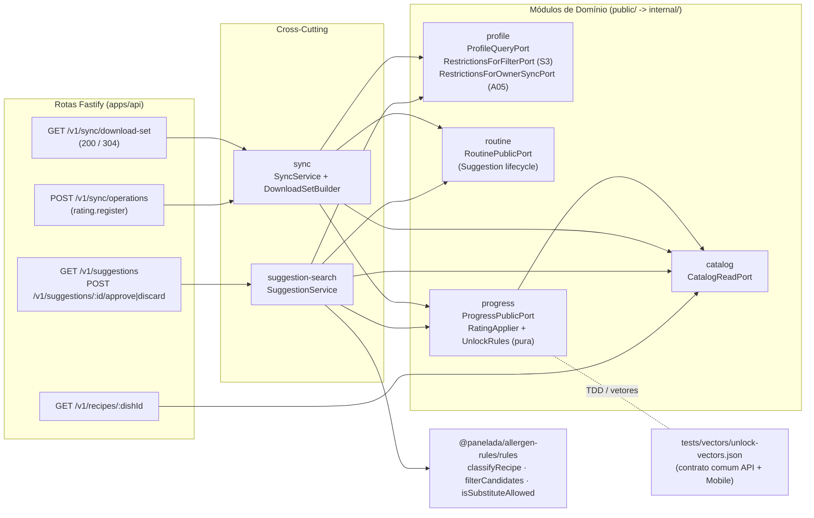

# Arquitetura de Implementação — MVP-04C (Sugestões, Receitas, Avaliações, Gamificação e Download-Set)

> **Escopo:** entrega da Issue `#41` (`MVP-04C`, Onda 1A — Estágio 1) na API Fastify (`apps/api`) e vetores compartilhados (`tests/vectors/`).
> **Rastreabilidade:** `US01`, `US02`, `US05`, `US09`, `US10`, `US12`, `US14`, `US15`, `US16`; `RN01`–`RN11`, `RN15`, `RN16`, `RN18`, `RN22`; `A05`, `A06`, `A08`, `A12`, `A13`; `ADR-002`, `ADR-006`, `ADR-008`, `ADR-014`, `ADR-015`, `ADR-016`; `S1`–`S8`, `P01`, `P05`, `P06`, `T01`, `R03`.

---

## 1. Visão Arquitetural da Entrega

A implementação preserva estritamente o **Monólito Modular vertical** (`ADR-002`) com módulos profundos (*deep modules*), portas estreitas em `public/` (`P06`), isolamento de tabelas por prefixo (`S8`) e fronteiras verificadas estaticamente via `eslint-plugin-boundaries` (`S1`–`S8`):

---

## 2. Fluxos Críticos e Garantias Arquiteturais

### 2.1 Sugestões Seguras por Alérgenos (`S3`, `A05`, `A06`, `A13`)
1. `GET /v1/suggestions` lê `X-Allergen-Package-Version` sem bloquear e resolve uma chave de sessão irreversível (`sha256` do token Bearer) para isolar descartes à sessão ativa (`RN11`).
2. `SuggestionService` consulta em paralelo:
   - `CatalogReadPort.listApprovedDishes()` (apenas pratos `approved`);
   - `RestrictionsForFilterPort.getActiveRestrictionCodes(accountId)` (**exclusivo** de `suggestion-search` pela regra `S3`, com decifragem *fail-closed* que lança `CorruptedRestrictionRecordError` sem vazar dados sensíveis se qualquer linha decifrar fora dos 19 códigos ANVISA + `lactose`);
   - `ProfileQueryPort.getPreferences(accountId)`;
   - `ProgressPublicPort.getCompletedDishIds(accountId)`;
   - `RoutinePublicPort.getSuggestionExclusions(accountId, sessionKey)`.
3. Aplica `classifyRecipe` e `filterCandidates` de `@panelada/allergen-rules/rules` (*fail-closed* estrito: `amendoim`, `unverified`, `source_declared` ou lista vazia sem `confirmedAllergenFree = true` nunca entram para quem tem restrição).
4. Registra **apenas contagens agregadas** (`compatible`, `incompatible`, `unconfirmed`, `allergenPackageVersion`) no log técnico — zero `accountId` e zero código de restrição (`ADR-014` §8–9, `A13 × A05`).
5. Exclui pratos concluídos (`RN01`/`RN10`), candidatas aprovadas e descartados na sessão atual (`RN11`), ordena priorizando culinárias preferidas (`rankCompatibleDishes`, pura), registra os itens apresentados via `RoutinePublicPort` e responde com `minPackageVersion`.

### 2.2 Ciclo de Vida de Sugestões (`RN11`, `P05`, `S8`)
- `modules/routine` é dono de `routine_suggestions` e `routine_idempotency_keys` (alinhado ao `diagrama-classes.md` §3/§5 e às fronteiras ESLint, já que `cross-cutting/sync` lê candidatas via `RoutinePublicPort` sem importar `suggestion-search`).
- `POST /v1/suggestions/:suggestionId/approve` e `/discard` exigem `Idempotency-Key` (UUID) processado pelo helper compartilhado `executeIdempotentHttpMutation` (`apps/api/src/shared/http-idempotency.ts`), com lock transacional (`pg_advisory_xact_lock`), replay idempotente, rejeição `422 key-reused` para reuso com rota/conteúdo diferente e TTL de 90 dias.

### 2.3 Avaliações e Gamificação 6D + Octalysis (`ADR-016`, `R03`, `T01`, `P01`, `P05`)
1. `POST /v1/sync/operations` recebe `rating.register`, abre transação `tx: Tx` no `SyncService` e despacha para `RatingApplier` pelo `OperationApplierRegistry` (`P01`).
2. `RatingApplier` valida o payload (`score` inteiro `0..10` — `RN05`), serializa por usuário (`pg_advisory_xact_lock`), valida existência do prato aprovado em `CatalogReadPort.getCatalogIndex(tx)` e grava `progress_ratings` com `id = opId` sem sobrescrever históricos anteriores (`RN06`).
3. Executa a função 100% pura `calculateUnlocks(rating, index, state)` (`UnlockRules`) com `switch` exaustivo (`assertNever`, `R03`) sobre os **8 tipos de marco (`RN03 a–h`)**: `dish`, `cuisine`, `n_cuisines`, `all_continents` (`america`, `africa`, `europe`, `asia`, `oceania`), `set`, `total_dishes`, `evolution_level` (com guarda anti-ciclo `visited` + `MAX_EVOLUTION_DEPTH = 10`) e `adaptation_count`.
4. Persiste `progress_evolution_unlocks` e `progress_badge_awards` com `ON CONFLICT DO NOTHING` (somente aditivo — `RN02`, `RN04`) na **mesma transação** em que o `SyncService` grava `sync_processed_operations` (`T01`, `P05`).

### 2.4 Conjunto Baixado (`GET /v1/sync/download-set`) e Isolamento de Restrições (`A05`)
- `DownloadSetBuilder` agrega exclusivamente fachadas `public/` de `profile`, `catalog`, `progress` e `routine` — zero SQL direto em tabelas de domínio (`S8`).
- A leitura de `{ restrictionType, consentAt }[]` para devolver ao próprio dono passa pela porta dedicada `modules/profile/public/restrictions-for-owner-sync.ts`, restrita no `eslint.config.mjs` **exclusivamente** a `cross-cutting/sync` e `app.ts` (nenhum módulo de domínio ou `identity` consegue importá-la).
- Calcula `version` determinística (SHA-256 canônico do snapshot) para suportar polling condicional com **HTTP `304 Not Modified`** quando `?version=` coincide.

---

## 3. Responsabilidade de Cada Arquivo

### Vetores Compartilhados e Contrato OpenAPI

| Arquivo | Tipo | Responsabilidade |
|---|---|---|
| `tests/vectors/unlock-vectors.json` | Criado | Suíte JSON compartilhada entre API (`UnlockRules`) e Mobile (`UnlockCalculator`, `MVP-04F`) cobrindo os 8 marcos `RN03 a–h`, `RN02`, `RN04`, `RN06`, guarda anti-ciclo e sincronização fora de ordem (`A08`). |
| `docs/fase2/04-contratos/openapi.yaml` | Alterado | Adiciona `X-Allergen-Package-Version` + `minPackageVersion` em `GET /v1/suggestions`, `candidates` em `DownloadSet` e `confirmedAllergenFree` em `Recipe` e `IngredientSubstitution` (`RN08`, `RN22`). |
| `apps/api/src/shared/openapi.generated.ts` | Regenerado | Tipos TypeScript gerados automaticamente via `pnpm contracts:generate` em sincronia estrita com `openapi.yaml`. |
| `eslint.config.mjs` | Alterado | Adiciona o tipo de elemento `api-profile-restrictions-owner-sync-port` restringindo `restrictions-for-owner-sync.ts` apenas a `cross-cutting/sync` e `app.ts`, preservando `S3` intacta. |

### Migração de Banco (`S8`)

| Arquivo | Tipo | Responsabilidade |
|---|---|---|
| `apps/api/drizzle/0003_progress_and_suggestions.sql` (+ `meta/`) | Criado | Cria tabelas privadas `progress_ratings` (PK composta `(user_id, id)` para isolamento multi-tenant de `opId`), `progress_evolution_unlocks`, `progress_badge_awards`, `routine_suggestions` (índice único parcial de candidata por `(user_id, dish_id)`) e `routine_idempotency_keys`, com zero FKs cross-módulo. |

### Camada Compartilhada e Composição (`apps/api/src/`)

| Arquivo | Tipo | Responsabilidade |
|---|---|---|
| `apps/api/src/shared/http-idempotency.ts` | Criado | Protocolo reutilizável de `Idempotency-Key` (`executeIdempotentHttpMutation`, TTL 90 dias, lock transacional, replay e `422 key-reused`) sobre a interface `HttpIdempotencyStore` provida por cada módulo dono (`P05`, `S8`). |
| `apps/api/src/app.ts` | Alterado | Raiz de composição: instancia `progressModule`, `routineModule`, `suggestionSearchModule`, conecta `RatingApplier` + `downloadSetPorts` ao `syncModule` e registra rotas de `suggestion-search`. |

### Módulo `profile` (`apps/api/src/modules/profile/`)

| Arquivo | Tipo | Responsabilidade |
|---|---|---|
| `public/restrictions-for-owner-sync.ts` | Criado | Fachada restrita (`RestrictionsForOwnerSyncPort`) que expõe `{ restrictionType, consentAt }[]` exclusivamente para `cross-cutting/sync` montar o `DownloadSet` do próprio dono (`A05`). |
| `public/profile-query.ts` | Alterado | Estende `ProfileQueryPort` com leituras não sensíveis necessárias ao `DownloadSet` (`getProfileSummary`, `listRestrictionTypes`). |
| `public/index.ts` | Alterado | Expõe `restrictionsForOwnerSync` na interface `ProfileModule`. |
| `internal/service.ts` | Alterado | Implementa `CorruptedRestrictionRecordError` e `decryptValidatedRestrictionCode` (*fail-closed* `A06`/D3 sem vazar valores sensíveis `A13`), além de `getDecryptedRestrictionsWithConsent`, `getProfileSummary` e `listRestrictionTypes`. |
| `internal/repository.ts` | Alterado | Implementa consultas Drizzle em `profile_users` e `profile_restriction_types` para `getProfileSummary` e `listRestrictionTypes` (`S8`). |

### Módulo `catalog` (`apps/api/src/modules/catalog/`)

| Arquivo | Tipo | Responsabilidade |
|---|---|---|
| `public/catalog-read.ts` | Alterado | Adiciona `confirmedAllergenFree` em `ApprovedRecipeDto`/substituições (`RN08`/`RN22`), `updatedAt` em `CatalogDishSummaryDto` (`recipesToDownload`) e `tx?: Tx` em `listApprovedDishes` e `getCatalogIndex`. |
| `internal/repository.ts` | Alterado | Retorna `confirmedAllergenFree` em `getApprovedRecipe`, `updatedAt` em `listApprovedDishes` e aceita `tx?: Tx` em `listApprovedDishes`/`getCatalogIndex` contra *pool starvation*. |

### Módulo `progress` (`apps/api/src/modules/progress/`)

| Arquivo | Tipo | Responsabilidade |
|---|---|---|
| `public/progress-public.ts` | Criado | Fachada pública `ProgressPublicPort` (`getCompletedDishIds`, `getProgressSnapshot`, `deleteData`) e DTOs de avaliação/badge (`P06`). |
| `public/index.ts` | Criado | Factory `createProgressModule` expondo `publicPort` e `appliers: [ratingApplier]`. |
| `internal/schema.ts` | Alterado | Declara as tabelas Drizzle `progress_ratings`, `progress_evolution_unlocks` e `progress_badge_awards` (junto de `progress_badge_definitions`, `S8`). |
| `internal/unlock-rules.ts` | Criado | Função pura `calculateUnlocks` com `switch` exaustivo (`assertNever`, `R03`) sobre os 8 marcos `RN03 a–h`, cálculo de profundidade com guarda anti-ciclo (`MAX_EVOLUTION_DEPTH = 10`) e imutabilidade do estado de entrada (`ADR-016`). |
| `internal/repository.ts` | Criado | `DrizzleProgressRepository`: acesso SQL restrito a `progress_*`, lock advisory por conta, gravação aditiva (`ON CONFLICT DO NOTHING`) e atendimento direto às leituras de `ProgressPublicPort` (sem camada `service.ts` rasa). |
| `internal/rating-applier.ts` | Criado | `OperationApplier<'rating.register'>` (`P01`): valida `RatingPayload` (`score` `0..10`), checa prato aprovado via `CatalogReadPort(tx)`, grava avaliação com `id = opId` e aplica `calculateUnlocks` + persistência de evoluções/badges na mesma `tx` (`T01`). |

### Módulo `routine` (`apps/api/src/modules/routine/`)

| Arquivo | Tipo | Responsabilidade |
|---|---|---|
| `public/routine-public.ts` | Criado | Fachada pública `RoutinePublicPort` para o ciclo de vida de `Suggestion` (exclusões por sessão/candidatas, registro de apresentadas, `approve`, `discard`, listagem de candidatas). |
| `public/index.ts` | Criado | Factory `createRoutineModule` instanciando repositório e serviço de sugestões. |
| `internal/schema.ts` | Alterado | Declara tabelas privadas `routine_suggestions` e `routine_idempotency_keys` (`S8`). |
| `internal/repository.ts` | Criado | `DrizzleRoutineRepository`: queries Drizzle em `routine_*` implementando `RoutineSuggestionStore` e `HttpIdempotencyStore`. |
| `internal/service.ts` | Criado | `RoutineSuggestionService`: regras de transição (`presented` → `candidate` / `discarded`, bloqueando transições inválidas com `422`), reutilização de sugestões apresentadas na mesma sessão e execução idempotente via `executeIdempotentHttpMutation` (`RN11`, `P05`). |

### Cross-Cutting `suggestion-search` e `sync` (`apps/api/src/cross-cutting/`)

| Arquivo | Tipo | Responsabilidade |
|---|---|---|
| `suggestion-search/index.ts` | Alterado | Factory `createSuggestionSearchModule` conectando serviço e rotas HTTP. |
| `suggestion-search/internal/service.ts` | Criado | `SuggestionService` e helper puro `rankCompatibleDishes`: único consumidor de `RestrictionsForFilterPort` (`S3`), filtragem via `classifyRecipe`/`filterCandidates`, log agregado sem dados sensíveis (`A13 × A05`), exclusões `RN01`/`RN10`/`RN11` e composição de `SuggestionItemDto`. |
| `suggestion-search/internal/routes.ts` | Criado | Plugin Fastify fino para `GET /v1/suggestions`, `POST /v1/suggestions/:suggestionId/approve` e `POST /v1/suggestions/:suggestionId/discard`, validação de query/`Idempotency-Key` e derivação de `sessionKey` via SHA-256 do token Bearer. |
| `sync/internal/download-set-builder.ts` | Criado | `DownloadSetBuilder` e helpers puros `buildCuisineCatalogIndex` / `computeDownloadSetVersion`: monta o snapshot completo das Camadas 1 e 2 (`DownloadSetDto`) apenas via fachadas públicas e calcula `version` para `304 Not Modified`. |
| `sync/internal/routes.ts` | Alterado | Adiciona rota autenticada `GET /v1/sync/download-set` (com `?version=` → `304` ou `200`). |
| `sync/index.ts` | Alterado | Estende `createSyncModule` para instanciar e registrar `DownloadSetBuilder` quando `downloadSetPorts` é fornecido. |

### Testes Automatizados (`apps/api/test/`)

| Arquivo | Tipo | Responsabilidade |
|---|---|---|
| `test/unit/profile-applier.test.ts` | Alterado | Adiciona teste TDD *fail-closed* comprovando que `ProfileService.getActiveRestrictionCodes` lança erro explícito sem expor código corrompido nem `accountId` (`A06`, `A13`, D3). |
| `test/unit/unlock-rules.test.ts` | Criado | Executor TDD dos 13 cenários de `tests/vectors/unlock-vectors.json`, validando cobertura dos 8 marcos `RN03 a–h` e imutabilidade do estado de entrada. |
| `test/unit/rating-applier.test.ts` | Criado | Testes unitários TDD do `RatingApplier` com falsos de `ProgressStore` e `CatalogReadPort` (desbloqueio de evolução + badges, repetição `RN06`, validação `RN05` e rejeição `404`). |
| `test/unit/suggestion-service.test.ts` | Criado | Testes unitários do `SuggestionService` validando filtro `amendoim`/`unverified`, exclusões (`completed`/`candidate`/`discarded`), ordenação por preferências, `noResult: true` e ausência de dados sensíveis nos logs (`A13 × A05`). |
| `test/integration/suggestions-progress-sync.integration.test.ts` | Criado | Teste de integração ponta a ponta contra PostgreSQL real (`panelada_test`) validando `/v1/suggestions`, `/approve` + `/discard` + rotação de sessão (`RN11`), `/v1/recipes/:dishId` + `isSubstituteAllowed`, `/v1/sync/operations` (`rating.register` + replay + repetição) e `/v1/sync/download-set` (`200` + `304`). |
