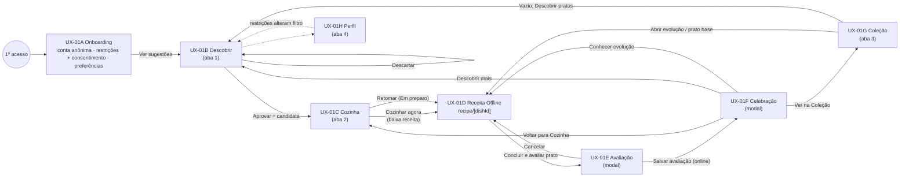

# UX da Onda 1A — Decisões Transversais, Jornada e Especificação das 8 Telas (`UX-01`)

> **Issue:** `UX-01` (#60) com as sub-issues `UX-01A`–`UX-01H` (#61–#68).
> **Protótipo navegável:** [`prototipo-onda1a/index.html`](./prototipo-onda1a/index.html) — arquivo único, sem dependências; abra com duplo clique no navegador.
> **Consumidores:** `MVP-04E` (#43 — Onboarding, Descobrir, Cozinha, Receita, Perfil) e `MVP-04F` (#44 — Avaliação, Celebração, Coleção). Refinamento visual posterior: `UX-02` (#69), sem reabrir esta leva.
> **Rastreabilidade:** `US01`, `US02`, `US05`, `US09`, `US10`, `US12`, `US14`–`US16`; `RN01`–`RN18`, `RN22`; `RNF02`–`RNF05`, `RNF07`, `RNF09`, `RNF10`; `A01`–`A06`, `A08`, `A12`; `ADR-003`, `ADR-005`, `ADR-008`, `ADR-012`, `ADR-014`–`ADR-016`; [`framework-gamificacao.md`](../fase2/03-modelagem/framework-gamificacao.md).

---

## Sumário

0. [Como usar este documento e o protótipo](#0-como-usar-este-documento-e-o-protótipo)
1. [Decisões transversais (contrato comum das 8 telas)](#1-decisões-transversais-contrato-comum-das-8-telas)
2. [Mapa de jornada e navegação](#2-mapa-de-jornada-e-navegação)
3. [Inventário de *nudges White Hat* × Core Drives](#3-inventário-de-nudges-white-hat--core-drives)
4. [`UX-01A` — Onboarding](#4-ux-01a--onboarding-61)
5. [`UX-01B` — Aba Descobrir](#5-ux-01b--aba-descobrir-62)
6. [`UX-01C` — Aba Cozinha](#6-ux-01c--aba-cozinha-63)
7. [`UX-01D` — Tela de Receita Offline](#7-ux-01d--tela-de-receita-offline-64)
8. [`UX-01E` — Fluxo de Avaliação](#8-ux-01e--fluxo-de-avaliação-65)
9. [`UX-01F` — Feedback Celebratório Pós-Avaliação](#9-ux-01f--feedback-celebratório-pós-avaliação-66)
10. [`UX-01G` — Aba Coleção](#10-ux-01g--aba-coleção-67)
11. [`UX-01H` — Aba Perfil](#11-ux-01h--aba-perfil-68)
12. [Checklist de revisão heurística (critérios de aceite)](#12-checklist-de-revisão-heurística-critérios-de-aceite)

---

## 0. Como usar este documento e o protótipo

- **Abrir o protótipo:** `docs/fase3/prototipo-onda1a/index.html` no navegador (Chrome/Firefox/Edge). A moldura central simula um aparelho de **360 × 800 dp** (Android médio). Não há rede, CDN nem build: todo o estado é simulado em memória e reinicia ao recarregar a página.
- **Painel do protótipo (fora da moldura):** atalhos para pular entre telas, carregar cenários (`Novo usuário`, `Usuário com progresso`) e **simular estados** (sem rede no Estágio 1, carregando, Descobrir esgotado, alerta de alérgeno, evolução bloqueada, variantes da celebração). O painel **não faz parte da UI do app**.
- **Modo Figma:** abra `index.html#figma` para esconder o painel e deixar apenas a moldura (útil para importar via plugin *html.to.design* ou capturar a tela). O protótipo usa apenas HTML/CSS + JS vanilla e CSS *custom properties* com os mesmos nomes dos tokens da §1.2, o que facilita reproduzir as telas como *frames* no Figma.
- **Fidelidade:** é um protótipo de **média fidelidade** — hierarquia, microcopy, estados e fluxo são o contrato para `#43`/`#44`; fotos são *placeholders* (gradiente + emoji em proporção `4:3`), e animações avançadas ficam para `UX-02`.
- **Mapeamento para o código:** cada seção de tela indica a pasta de destino em `apps/mobile/src/features/<feature>/ui/` (arquitetura *feature-first* — ver [`docs/dev/ARCHITECTURE.md`](../dev/ARCHITECTURE.md)).

---

## 1. Decisões transversais (contrato comum das 8 telas)

> Valem para **todas** as sub-issues `UX-01A`–`UX-01H`. Qualquer tela que precise quebrar uma delas abre nova decisão em issue própria.

### 1.1 Arquitetura de informação e navegação (`#38`, `#42`)

| Rota (Expo Router — `#42`) | Tela | Tipo | Exige rede no Estágio 1? |
|---|---|---|---|
| `onboarding` | Onboarding (3 passos) | Pilha, só no 1º acesso | Sim (`POST /v1/accounts/anonymous`, salvar restrições) |
| `(tabs)/discover` | **Descobrir** | Aba 1 | Sim (sugestões vêm da API — `ADR-001`) |
| `(tabs)/kitchen` | **Cozinha** | Aba 2 | Leitura não; "Cozinhar agora" sim (download) |
| `(tabs)/collection` | **Coleção** | Aba 3 | Não (dados locais no `SqlCipherDatabase`) |
| `(tabs)/profile` | **Perfil** | Aba 4 | Leitura não; editar restrição/preferência sim |
| `recipe/[dishId]` | **Receita** | Pilha sobre as abas | Não, se baixada (`DownloadSet`) |
| `recipe/[dishId]/rate` | **Avaliação** | Modal em tela cheia | Sim (salvar `Rating`) |
| `recipe/[dishId]/celebrate` | **Celebração** | Modal em tela cheia | Não (resultado já devolvido pelo salvamento) |

Regras:
1. **Barra de abas fixa** com 4 itens (ícone + rótulo sempre visível, nunca só ícone): `Descobrir`, `Cozinha`, `Coleção`, `Perfil`. Fica oculta apenas no Onboarding, na Avaliação e na Celebração (fluxos focados).
2. **Sem becos sem saída:** toda tela tem saída explícita — botão Voltar no cabeçalho das telas de pilha, botão **Fechar/Cancelar** nos modais e CTAs de continuidade nos estados vazios (ver tabela de saídas em cada seção).
3. **Rotas canônicas de ida e volta:** `Descobrir → (aprovar) → Cozinha → Receita → Avaliação → Celebração → Coleção | Cozinha | Descobrir`. A `Coleção` abre `Receita` de evoluções (somente leitura quando bloqueada) e retorna para si mesma.
4. **Indicador de novidade, não de cobrança:** a aba `Cozinha` recebe um ponto discreto (`primary`) quando uma candidata nova chega; o ponto some ao abrir a aba. **Nunca** usar contadores de pendência vermelhos.

### 1.2 Design tokens semânticos (alimentam `apps/mobile/src/shared/theme/`)

Formato **diretamente compatível com `StyleSheet`** (hex, números em dp, `fontWeight` como *string*), mantendo as chaves já usadas por `shared/theme/index.ts` em `#42` (`colors`, `spacing`, `radius`, `typography`) e acrescentando `elevation` e `touchTarget`. Em `#43`, basta substituir o arquivo provisório por este objeto (as chaves antigas `background`, `textSecondary`, `border`, `danger` e `onPrimary` foram mantidas).

```ts
// Destino: apps/mobile/src/shared/theme/index.ts (substituído em MVP-04E #43)
export const colors = {
  // Superfícies
  background: '#FAF7F2', // fundo das telas (papel culinário, quente)
  surface: '#FFFFFF', // cards, folhas, modais
  surfaceAlt: '#F3EDE4', // blocos secundários, skeleton, chips inativos
  border: '#E3DCD1',
  // Marca e ações
  primary: '#B4441F', // CTA primário (terracota)
  onPrimary: '#FFFFFF',
  primarySoft: '#FBE9E1', // fundo de chip selecionado / destaque leve
  // Texto
  textPrimary: '#1F2937',
  textSecondary: '#4B5563',
  textMuted: '#6B7280', // metadados (≥ 4,5:1 sobre background)
  // Segurança alimentar (A06) — nunca reutilizar para outro significado
  allergenSafe: '#166534', // selo "Verificado"
  allergenSafeSoft: '#DCFCE7',
  allergenWarning: '#92400E', // selo "Declarado pela fonte" + banner RN16
  allergenWarningSoft: '#FEF3C7',
  allergenDanger: '#B91C1C', // "Compatibilidade não confirmada" / "Não verificado"
  allergenDangerSoft: '#FEE2E2',
  onAllergenDanger: '#FFFFFF',
  // Estado de rede / sincronização (ADR-008)
  offlineBanner: '#E2E8F0',
  onOfflineBanner: '#1E293B',
  // Recompensas (ADR-016) — desbloqueios e badges
  successUnlock: '#6D28D9',
  successUnlockSoft: '#EDE9FE',
  progress: '#B4441F', // barras de % da culinária (mesma família do primary)
  danger: '#B91C1C', // erros técnicos genéricos (não alimentares)
} as const;

export const spacing = { xxs: 2, xs: 4, sm: 8, md: 16, lg: 24, xl: 32, xxl: 48 } as const;

export const radius = { sm: 8, md: 12, lg: 20, pill: 999 } as const;

export const typography = {
  display: { fontSize: 28, lineHeight: 34, fontWeight: '700' }, // celebração
  title: { fontSize: 22, lineHeight: 28, fontWeight: '700' }, // título de tela
  subtitle: { fontSize: 18, lineHeight: 24, fontWeight: '600' }, // títulos de seção/card
  body: { fontSize: 16, lineHeight: 24, fontWeight: '400' },
  stepBody: { fontSize: 22, lineHeight: 32, fontWeight: '500' }, // passo atual (bancada, A04)
  caption: { fontSize: 14, lineHeight: 20, fontWeight: '400' },
  overline: { fontSize: 12, lineHeight: 16, fontWeight: '700' }, // rótulos em caixa alta
  button: { fontSize: 16, lineHeight: 20, fontWeight: '600' },
} as const;

// Android usa `elevation`; iOS usa shadow*. Valores pensados para ambos.
export const elevation = {
  none: { elevation: 0 },
  card: { elevation: 2, shadowColor: '#000', shadowOpacity: 0.08, shadowRadius: 6, shadowOffset: { width: 0, height: 2 } },
  sheet: { elevation: 8, shadowColor: '#000', shadowOpacity: 0.16, shadowRadius: 16, shadowOffset: { width: 0, height: -4 } },
} as const;

export const touchTarget = { min: 48, comfortable: 56 } as const; // dp — §1.6
```

**Contraste verificado (WCAG 2.1, texto normal exige ≥ 4,5:1):**

| Texto / primeiro plano | Fundo | Razão | Uso |
|---|---|---|---|
| `textPrimary` `#1F2937` | `background` `#FAF7F2` | 13,7:1 | texto principal |
| `textSecondary` `#4B5563` | `background` | 7,1:1 | descrições |
| `textMuted` `#6B7280` | `background` | 4,5:1 | metadados (mínimo AA) |
| `textMuted` `#6B7280` | `surface` `#FFFFFF` | 4,8:1 | metadados em card |
| `onPrimary` `#FFFFFF` | `primary` `#B4441F` | 5,5:1 | CTA primário |
| `primary` `#B4441F` | `surface` | 5,5:1 | links, botões secundários |
| `primary` `#B4441F` | `primarySoft` `#FBE9E1` | 4,7:1 | chip selecionado |
| `allergenSafe` `#166534` | `allergenSafeSoft` `#DCFCE7` | 6,5:1 | selo Verificado |
| `allergenWarning` `#92400E` | `allergenWarningSoft` `#FEF3C7` | 6,4:1 | selo Declarado / banner RN16 |
| `allergenDanger` `#B91C1C` | `allergenDangerSoft` `#FEE2E2` | 5,3:1 | selo Não verificado |
| `onAllergenDanger` `#FFFFFF` | `allergenDanger` | 6,5:1 | alerta fail-closed |
| `onOfflineBanner` `#1E293B` | `offlineBanner` `#E2E8F0` | 11,9:1 | faixa sem rede / `lastSyncAt` |
| `successUnlock` `#6D28D9` | `successUnlockSoft` `#EDE9FE` | 6,0:1 | evolução / badge |

> **Par proibido:** `textMuted` sobre `surfaceAlt` (4,15:1 — reprova AA); em blocos `surfaceAlt` use `textSecondary`.
>
> Os valores acima foram calculados pela fórmula de luminância relativa da WCAG (script descartável executado na revisão desta issue). Se `UX-02` mudar a paleta, recalcule a tabela.

**No protótipo**, os mesmos tokens existem como CSS *custom properties* (`--color-surface`, `--color-allergen-danger`, `--space-md`, `--radius-md` …), com correspondência 1:1 de nome (camelCase → kebab-case).

### 1.3 Tom de voz e ética motivacional *White Hat* (`ADR-016`, `RNF09`, `RN04`, `RN12`)

**Princípios de microcopy (PT-BR, `ADR-015`):** segunda pessoa informal ("você"), frases curtas, verbo de ação no CTA ("Cozinhar agora", "Salvar avaliação"), celebração proporcional ao que aconteceu e erros que dizem **o que aconteceu + o que foi preservado + o que fazer**.

| ❌ Proibido (Black Hat / punitivo) | ✅ Preferido (White Hat) | Por quê |
|---|---|---|
| "Você perdeu sua sequência de 5 dias!" | *(não existe sequência)* | `RNF09`, CD8 proibido |
| "Você tem 3 candidatas paradas há 7 dias." | "Que tal transformar uma candidata em jantar hoje?" | `RN12`: sem cobrança por inatividade |
| "Avaliação incompleta: preencha o relato." | "Só a nota é obrigatória. O resto é seu, se quiser." | `RNF10` |
| "Erro! Falha ao salvar." | "Sem conexão agora. Seu texto continua aqui — toque em Tentar novamente quando a internet voltar." | `ADR-008` Estágio 1 |
| "Badge perdido." / "Nível rebaixado." | *(nunca acontece)* | `RN04`: badges são definitivos |
| "Bloqueado! Pague/espere para liberar." | "Conclua **Tian provençal** para abrir esta evolução." | CD6 positivo, `RN02` |
| "Você pulou as preferências." | "Pode ajustar quando quiser no Perfil." | sem culpa por etapa opcional |

**Core Drives permitidos:** `CD1` (significado épico — atravessar continentes), `CD2` (progresso visível), `CD3` (autoria criativa), `CD4` (posse — coleção e caderno), `CD6` **apenas positivo** (desejo de desbloqueio sem temporizador/paywall) e `CD7` (curiosidade). `CD5` fica fora da Onda 1A (`US17` é *Could*). `CD8` é **proibido**.

### 1.4 Hierarquia visual de segurança alimentar (`A06`, `US09`, `RN08`, `RN16`, `RN22`)

Padrão **único** reutilizado em Onboarding, Descobrir, Receita, Coleção e Perfil (componente sugerido: `shared/ui/allergen/`):

**(a) Banner discreto `RN16`** — aparece **somente quando o usuário tem ≥ 1 restrição**:
> ℹ️ *Verificamos apenas os 19 alérgenos do vocabulário controlado (ANVISA + lactose). Confira sempre o rótulo dos ingredientes.*

Fundo `allergenWarningSoft`, texto `allergenWarning`, ícone ℹ️, 1–2 linhas, não fechável na Receita e no Perfil (fixo); em Descobrir fica no topo da lista, sem ocupar o card.

**(b) Selo de `allergenState`** (sempre visível em card de prato e cabeçalho de receita — `RN16`):

| `allergenState` | Rótulo | Ícone | Cores |
|---|---|---|---|
| `verified` | **Verificado** | ✓ | `allergenSafe` sobre `allergenSafeSoft` |
| `source_declared` | **Declarado pela fonte** | ◐ | `allergenWarning` sobre `allergenWarningSoft` |
| `unverified` | **Não verificado** | ? | `allergenDanger` sobre `allergenDangerSoft` |

O selo é **ícone + texto** (nunca só cor — daltonismo). Ao tocar, abre folha curta explicando o significado do estado.

**(c) Alerta *fail-closed* "Compatibilidade não confirmada"** — exibido quando o usuário tem restrição **e** a revalidação local (`classifyRecipe` de `packages/allergen-rules`) retorna `incompatible` **ou** `unconfirmed` (inclui `unverified`, `source_declared` sem confirmação e lista vazia sem `confirmedAllergenFree` — `ADR-014`):

- Bloco de largura total, logo abaixo do cabeçalho da receita, fundo `allergenDanger`, texto `onAllergenDanger`, ícone ⚠️, título fixo **"Compatibilidade não confirmada"** + motivo em linguagem simples:
  - `allergen_match` → "Esta receita contém **Amendoim**, que está nas suas restrições."
  - `allergen_state_unverified` / `empty_allergens_unconfirmed` → "Os alérgenos desta receita ainda não foram verificados."
  - `source_declared_unconfirmed` → "A lista de alérgenos vem da fonte original e não foi confirmada pela curadoria."
- **Não é fechável, não colapsa e não some ao rolar o conteúdo** (repete-se em forma compacta acima do botão "Concluir e avaliar prato"). Nunca usar tom amarelo/neutro para esse estado — ambiguidade aqui é risco à saúde.
- Ingredientes que causam o *match* ficam destacados na lista com rótulo "Contém alérgeno do seu perfil".
- Sugestões em Descobrir **nunca** mostram pratos `incompatible`/`unconfirmed` para quem tem restrição (`RN08`) — o alerta aparece na Receita/Cozinha quando o prato foi aprovado **antes** de a restrição ser cadastrada, ou ao abrir uma evolução pela Coleção.

**Rótulos amigáveis dos 19 códigos** (os códigos permanecem em português no contrato — `ADR-015`). O vocabulário tem **19 códigos no total: 18 da ANVISA RDC nº 727/2022 + `lactose`** (fonte: `packages/allergen-rules/src/types.ts`; o texto da issue "19 ANVISA + lactose" foi corrigido aqui). Agrupamento usado na seleção:

| Grupo | Código → rótulo |
|---|---|
| Glúten | `trigo_centeio_cevada_aveia` → Trigo, centeio, cevada e aveia (glúten) |
| Leite | `leite` → Leite (proteína do leite) · `lactose` → Lactose (intolerância) |
| Ovos | `ovo` → Ovos |
| Peixes e frutos do mar | `peixe` → Peixes · `crustaceos` → Crustáceos |
| Leguminosas | `amendoim` → Amendoim · `soja` → Soja |
| Castanhas e nozes | `amendoa` → Amêndoa · `avela` → Avelã · `castanha_caju` → Castanha-de-caju · `castanha_brasil` → Castanha-do-pará · `macadamia` → Macadâmia · `noz` → Nozes · `peca` → Pecã · `pistache` → Pistache · `pinoli` → Pinoli · `castanha_castanea` → Castanha-portuguesa |
| Outros | `latex` → Látex natural |

### 1.5 Padrão de estados de tela e offline no Estágio 1 (`ADR-008`)

Toda tela especifica os 4 estados abaixo. Componentes sugeridos: `shared/ui/state/{Skeleton,EmptyState,OfflineNotice,ErrorNotice}`.

| Estado | Padrão visual | Regra |
|---|---|---|
| **Normal** | Conteúdo da tela | — |
| **Carregando** | *Skeleton* com a forma do conteúdo final (blocos `surfaceAlt` pulsando); botões em envio mostram rótulo de progresso ("Salvando…") e ficam desabilitados | Nada de *spinner* em tela cheia por mais de 1 s sem texto explicativo |
| **Vazio** | Ilustração/emoji + título acolhedor + 1 frase + **1 CTA construtivo** | Nunca culpar o usuário ("Você ainda não…" → "Sua coleção começa no primeiro prato") |
| **Erro / sem rede** | Faixa `offlineBanner` no topo ("Sem conexão") + mensagem contextual na ação que falhou + botão **Tentar novamente** | **Nunca apaga nem corrompe estado local** nem texto digitado |

**Estágio 1 — o que funciona sem rede:**

| Funciona offline (leitura local `SqlCipherDatabase`) | Exige rede (`DirectOnlineOperationEnqueuer`) |
|---|---|
| Abrir receita baixada e navegar nos passos (`Em preparo`) | Criar conta anônima (Onboarding) |
| Ver Coleção, Evoluções, Badges e Histórico já sincronizados | Carregar sugestões, aprovar e descartar (Descobrir) |
| Ver restrições e preferências salvas (Perfil) | "Cozinhar agora" (baixar receita + foto WebP) |
| Ver substituições já baixadas com a receita | Salvar avaliação; salvar/remover restrição e preferências |

Mensagem padrão para ação online sem rede (variar só o verbo):
> **Sem conexão agora.** Para *salvar sua avaliação*, precisamos de internet. Nada foi perdido — tente de novo quando a conexão voltar. **[Tentar novamente]**

Telas com dados offline exibem discretamente **"Disponível offline · atualizado em DD/MM às HH:MM"** (`lastSyncAt`), em `caption`/`textMuted` (nunca como alerta). No Estágio 2 (`OutboxOperationEnqueuer`), as mesmas telas trocam a mensagem por "Salvo no aparelho — enviaremos quando a conexão voltar", sem redesenho.

### 1.6 Usabilidade prática e acessibilidade mobile

- **Idioma:** 100% PT-BR em textos de UI (`ADR-015`); datas `DD/MM/AAAA`, horas `HH:MM`, decimal com vírgula ("3,5 estrelas").
- **Alvos de toque:** mínimo **48 × 48 dp** (`touchTarget.min`); botões de navegação de passo e CTA de conclusão na Receita usam **56 dp** (`touchTarget.comfortable`) — mãos molhadas/ocupadas.
- **Contraste:** pares da tabela da §1.2 (AA). Estado nunca comunicado só por cor (ícone + texto).
- **Tipografia:** corpo 16; passo atual da receita 22 (`stepBody`) legível a ~50 cm da bancada. Respeitar *Dynamic Type*/escala de fonte do sistema (sem `allowFontScaling={false}`).
- **Hierarquia de CTA:** por tela, no máximo **1 CTA primário** (preenchido `primary`); secundários com contorno `primary`; terciários como link de texto. Ações destrutivas (remover restrição) ficam em texto `danger` e sempre pedem confirmação.
- **Leitores de tela:** todo ícone-botão tem `accessibilityLabel` em PT-BR (ex.: "Descartar sugestão", "Próximo passo"); selos de alérgeno leem o rótulo completo ("Alérgenos: verificado").
- **Movimento:** animações ≤ 300 ms e respeitando "reduzir movimento" do sistema.

---

## 2. Mapa de jornada e navegação



**Jornada ponta a ponta (cenário Marina, ≤ 2 min até a 1ª sugestão — `A02`):**

| # | Tela | Ação do usuário | Resposta do sistema | Saídas |
|---|---|---|---|---|
| 1 | Onboarding · Boas-vindas | "Começar" | Cria conta anônima (loading curto) | Passo 2 |
| 2 | Onboarding · Restrições | "Não tenho restrições — continuar" **ou** marca alérgenos + consentimento | Salva restrições com `consentAt` | Passo 3 |
| 3 | Onboarding · Preferências | Marca culinárias ou "Pular" | Prioriza sugestões (`RN10`) | Descobrir |
| 4 | Descobrir | "Quero cozinhar" | Toast "Foi para Cozinha → Candidatas" + ponto na aba | Próxima sugestão / aba Cozinha |
| 5 | Cozinha | "Cozinhar agora" na candidata | Baixa receita + foto, move para `Em preparo (offline)` | Receita |
| 6 | Receita | Avança passos, consulta trocas | Passo atual em destaque; funciona offline | Avaliação / Voltar |
| 7 | Avaliação | Escolhe nota (0–5, meia estrela) e "Salvar" | `Rating` salva (`RN01`) | Celebração |
| 8 | Celebração | "Ver na Coleção" | Mostra % da culinária, evolução e badges novos | Coleção / Cozinha / Descobrir |
| 9 | Coleção | Alterna sub-visões | Progresso, cadeia, badges, histórico | Receita (evolução) / Descobrir |
| 10 | Perfil | Adiciona/remove restrição | Atualiza banner `RN16` e filtro de sugestões | Descobrir |

---

## 3. Inventário de *nudges White Hat* × Core Drives

| ID | Tela | *Nudge* (microcopy de referência) | Core Drive | Fase Octalysis | Regra/limite ético |
|---|---|---|---|---|---|
| N01 | Onboarding | "Em menos de 2 minutos você vê seu primeiro prato." (barra "Passo 1 de 3") | CD2 | Discovery | Promessa verdadeira (`A02`) |
| N02 | Onboarding | Atalho "Não tenho restrições — continuar" em destaque | CD2 (baixo atrito) | Onboarding | Sem pressão para cadastrar dado sensível |
| N03 | Onboarding | "Pular" nas preferências: "Pode ajustar quando quiser no Perfil." | — (remoção de atrito) | Onboarding | Etapa opcional sem culpa |
| N04 | Descobrir | Pista no card: "✨ Primeira receita **tailandesa** da sua coleção" | CD7 + CD4 | Discovery/Scaffolding | 1 pista por card, no máximo |
| N05 | Descobrir | Pista no card: "🔓 Abre a evolução **Tian provençal**" (prato base de cadeia) | CD6 positivo + CD2 | Scaffolding | Sem temporizador |
| N06 | Descobrir | Toast ao aprovar: "Foi para Cozinha → Candidatas" + ponto na aba | CD2 (feedback) | Scaffolding | Ponto some ao abrir a aba |
| N07 | Descobrir (vazio) | "Você viu todas as sugestões desta rodada. Que tal cozinhar uma candidata?" | CD2 | Scaffolding | CTA construtivo, nunca "acabou" seco |
| N08 | Cozinha | "Escolha uma e a receita fica salva no aparelho — funciona até sem internet." | CD2 + CD3 | Scaffolding | Convite, não cobrança (`RN12`) |
| N09 | Cozinha (vazio) | "Sua cozinha está esperando o primeiro prato. Descubra algo novo!" | CD7 | Onboarding | — |
| N10 | Receita | "Passo 3 de 6" + barra de progresso dos passos | CD2 | Scaffolding | — |
| N11 | Receita | Trocas seguras: "Trocou? Registre na avaliação — entra no seu caderno." | CD3 | Scaffolding | Só substitutos aprovados (`RN22`) |
| N12 | Avaliação | Campo Alterações: "Deu seu toque na receita? Registrar suas adaptações entra no seu caderno e conta para o badge **Toque Pessoal**." | CD3 + CD2 | Scaffolding | Campo opcional (`RNF10`) |
| N13 | Avaliação (repetição) | "Este preparo entra como um novo registro — os anteriores continuam guardados." | CD4 | Endgame | `RN06` |
| N14 | Celebração | "Prato registrado na sua Coleção!" + barra % animada ("faltam 8 pratos da culinária Francesa") | CD2 + CD4 | Scaffolding | *Goal-gradient* honesto (`RN07`) |
| N15 | Celebração | "🔓 Evolução desbloqueada: **Tian provençal** — Conhecer" | CD6 positivo + CD2 | Scaffolding | Só se `newEvolutionUnlocks ≠ ∅` |
| N16 | Celebração | Badge: ícone + nome + motivo ("Concluiu seu primeiro prato") | CD2 + CD4 | Onboarding→Endgame | Só se `newBadgeAwards ≠ ∅` |
| N17 | Celebração (repetição) | "Mais um registro no seu caderno!" | CD4 | Endgame | Calor proporcional, sem tela vazia |
| N18 | Coleção · Culinárias | "Francesa · 2 de 10 · faltam 8" | CD2 + CD4 | Scaffolding | `RN07` |
| N19 | Coleção · Evoluções | Nó bloqueado: "Conclua **Tian provençal** para abrir" (toque leva ao prato base) | CD6 positivo | Scaffolding | `RN02` |
| N20 | Coleção · Badges | Próximos marcos: "Chef de Rotina · 2 de 5 pratos" | CD2 (*goal-gradient*) | Scaffolding | Critério verificável (`RN04`) |
| N21 | Coleção · Badges | Conquistados: "Conquistado em 23/11/2026 · é seu para sempre" | CD4 | Endgame | `RN04` (nunca revogado) |
| N22 | Coleção · Histórico | Selo "Toque pessoal" em registros com `changes` | CD3 + CD4 | Endgame | — |
| N23 | Coleção (vazio) | "Sua coleção começa no primeiro prato avaliado." | CD4 | Onboarding | — |
| N24 | Celebração / Coleção | Badge de continente: "Você já cozinhou em 2 dos 5 continentes 🌍" | CD1 | Endgame | — |

**Excluídos de propósito:** *streaks*, contagem regressiva, notificação de inatividade, ranking (`RN20`), pontos numéricos (`RN19`), perda de nível/badge (`RN04`), "itens atrasados" (`RN12`).

---

## 4. `UX-01A` — Onboarding (#61)

- **Rastreabilidade:** `US09`; `RN08`, `RN09`, `RN10`, `RN16`; `RNF02` (`A02` ≤ 2 min), `RNF06` (`A05`, `A06`); `ADR-005`, `ADR-007`, `ADR-014`.
- **Destino no código (`#43`):** `apps/mobile/src/features/profile/ui/onboarding/`.
- **Objetivo:** levar do primeiro toque à primeira sugestão compatível em ≤ 2 min, sem cadastro/senha, com consentimento LGPD explícito somente para quem informa restrição.

### Passos e anatomia

| Passo | Conteúdo | CTA primário | Secundário |
|---|---|---|---|
| **1. Boas-vindas** | Logo + "Panelada" · título "Cozinhe o mundo, um prato por vez" · 3 bullets (sugestões que respeitam suas restrições · receita offline na bancada · coleção que cresce a cada prato) · nota "Sem cadastro nem senha: criamos uma conta anônima só para guardar seu progresso." | **Começar** | — |
| **2. Restrições** | "Alguém vai comer com restrição alimentar?" · botão de destaque **"Não tenho restrições — continuar"** (largura total, contorno) · campo de busca "Buscar alérgeno (ex.: leite, castanha)" · chips agrupados (§1.4) · ao marcar ≥ 1 chip aparece o **cartão de consentimento** | **Salvar e continuar** (aparece quando há ≥ 1 restrição) | "Não tenho restrições — continuar" |
| **3. Preferências** | "Quais cozinhas você quer explorar?" · chips de culinária com bandeira/emoji (multi-seleção) · nota "Usamos isso só para ordenar as sugestões." | **Ver minhas sugestões** | **Pular** ("Pode ajustar quando quiser no Perfil.") |

Indicador "Passo N de 3" + barra fina no topo; botão Voltar a partir do passo 2.

### Consentimento LGPD (`A05`, `RN09`, `consentAt`)

Cartão `surface` com borda `allergenWarning`, visível assim que há ≥ 1 restrição marcada:
> 🔒 **Restrição alimentar é um dado sensível de saúde.** Usamos só para filtrar sugestões e alertar sobre alérgenos. Ela fica cifrada no seu aparelho e no servidor, nunca vai para logs nem para a IA, e você pode remover quando quiser no Perfil.
> ☐ **Concordo com o tratamento das minhas restrições alimentares para esses fins.**

- Checkbox **desmarcado por padrão** (alvo ≥ 48 dp em toda a linha).
- Ao salvar, o app registra `consentAt` (data/hora do aceite) junto com as restrições.
- Desmarcar todos os chips esconde o cartão e zera o aceite (nunca guardar consentimento sem dado).

### Estados

| Estado | Comportamento | Microcopy |
|---|---|---|
| **Padrão sem restrições** | Passo 1 → "Não tenho restrições — continuar" → Passo 3 → Descobrir (3 toques mínimos) | — |
| **Com restrições + consentimento** | Chips marcados → checkbox → "Salvar e continuar" → loading curto → Passo 3 | "Salvando suas restrições…" |
| **Validação (sem aceite)** | Toque em "Salvar e continuar" sem checkbox → cartão ganha borda `allergenDanger` + mensagem inline; nada é salvo | "Para guardar suas restrições, marque o consentimento acima." |
| **Carregando conta** (`POST /v1/accounts/anonymous`) | Botão "Começar" vira "Preparando sua cozinha…" desabilitado | "Preparando sua cozinha…" |
| **Sem rede (Estágio 1)** | Faixa "Sem conexão" + mensagem; seleção feita é mantida na tela | "Sem conexão agora. Precisamos de internet só neste primeiro acesso para criar sua conta. Nada foi perdido. **[Tentar novamente]**" |
| **Vazio** | N/A (busca sem resultado: "Nenhum alérgeno com esse nome. Os 19 verificados estão nos grupos abaixo.") | — |

**Saídas:** Passo 3 → `Descobrir` (substitui a pilha; voltar não retorna ao Onboarding).

---

## 5. `UX-01B` — Aba Descobrir (#62)

- **Rastreabilidade:** `US01`, `US02`; `RN08`, `RN10`, `RN11`, `RN16`; `RNF03` (`A01`), `RNF04` (`A03` ≤ 2 toques).
- **Destino no código (`#43`):** `apps/mobile/src/features/suggestions/ui/`.

### Anatomia

1. **Cabeçalho:** "Descobrir" + subtítulo "Sugestões compatíveis com seu perfil".
2. **Banner `RN16`** (só com restrição) — §1.4(a), compacto, acima do card.
3. **Card em destaque (1 por vez):**
   - Foto `4:3` (WebP padronizado — `ADR-012`) e, logo abaixo, o selo `allergenState` (fora da foto para não depender do contraste da imagem).
   - Nome do prato (`title`) · bandeira + culinária/país · ⏱ tempo · dificuldade (Fácil/Média/Difícil).
   - **Pista de curiosidade/coleção** (1 linha, opcional, `successUnlockSoft`): N04 ou N05. Prioridade: evolução que o prato desbloqueia > culinária inédita na coleção > nenhuma.
   - Contador discreto "Mais 4 sugestões nesta rodada" (não é meta, é orientação).
4. **Ações de 1 toque** (lado a lado, ≥ 56 dp, abaixo do card): **Descartar** (secundário, ícone ✕) e **Quero cozinhar** (primário, ícone ♥). Tocar na foto/nome abre a Receita em modo leitura (detalhe), sem sair do fluxo.

### Feedback

- **Aprovar:** card desliza para a direita, próximo card entra; toast "Foi para **Cozinha → Candidatas**" com ação "Ver"; ponto `primary` na aba Cozinha.
- **Descartar:** próximo card imediatamente; sem confirmação (é reversível — pode reaparecer em sessões futuras, `RN11`).
- Atingir o objetivo `A03`: decidir sobre um prato em **1 toque**; ver a receita em **2**.

### Estados

| Estado | Comportamento | Microcopy |
|---|---|---|
| **Normal** | Card + ações | — |
| **Carregando** | *Skeleton* do card (foto, 2 linhas, 2 botões) | "Buscando pratos para você…" |
| **Vazio (sessão esgotada)** | Emoji 🍽️ + texto + CTA primário "Ir para a Cozinha" + secundário "Revisar restrições e preferências" (→ Perfil) | "Você viu todas as sugestões desta rodada. Que tal cozinhar uma das suas candidatas? Novas sugestões aparecem na próxima visita." |
| **Sem rede (Estágio 1)** | Faixa "Sem conexão" + estado ilustrado + CTA "Ir para a Cozinha" (receitas baixadas funcionam) + "Tentar novamente" | "Sugestões precisam de internet. Suas receitas baixadas continuam na Cozinha, mesmo offline." |
| **Ação sem rede** | Aprovar/descartar sem rede mostra toast e **mantém o card** | "Sem conexão — não deu para salvar sua escolha. O prato continua aqui." |

**Regra de segurança:** com restrição cadastrada, a lista só contém `compatible` (`RN08`); sem restrição, todos os estados aparecem com o selo correspondente (`RN16`).

---

## 6. `UX-01C` — Aba Cozinha (#63)

- **Rastreabilidade:** `US02`, `US05`; `RN01`, `RN12`; `A04`; `ADR-001`, `ADR-008`.
- **Destino no código (`#43`):** `apps/mobile/src/features/recipe/ui/kitchen/` (tela da aba; reaproveita card de prato de `suggestions`).

### Anatomia (ponte da Onda 1A — `#38`)

1. **Cabeçalho:** "Cozinha" + linha de *nudge* N08 (só quando há candidatas e nada em preparo).
2. **Seção `Em preparo (offline)`** — no topo, só quando existe `LocalCookingState`:
   - Card largo com foto, nome, "Passo 3 de 6", barra de passos, selo `allergenState` e linha **"Disponível offline · atualizado em 23/11 às 14:32"** (`lastSyncAt`).
   - CTA primário **Continuar preparo** (abre a Receita no passo salvo) + link **Concluir e avaliar**.
   - Se a revalidação local der `incompatible`/`unconfirmed`, o card mostra a versão compacta do alerta §1.4(c).
3. **Seção `Candidatas`** — lista de cards compactos (foto 72 dp, nome, culinária, tempo, selo) com botão **Cozinhar agora** (secundário; vira primário se não houver nada em preparo) e explicação curta na primeira vez: "Ao tocar, baixamos receita e foto para usar sem internet."
4. **Espaço reservado para a Onda 1B (`MVP-05`):** bloco desabilitado "Em breve: Plano da semana e Lista de compras" entre as seções — na Onda 1B vira a seção `Plano da semana` acima de `Candidatas` sem mudar as demais.

### Estados

| Estado | Comportamento | Microcopy |
|---|---|---|
| **Populado** | Em preparo + Candidatas | — |
| **Só candidatas** | Sem seção Em preparo; 1ª candidata com CTA primário | "Que tal transformar uma candidata em jantar hoje?" |
| **Vazio** | Emoji 🍳 + texto + CTA "Descobrir pratos" | "Sua cozinha está esperando o primeiro prato. Aprove sugestões em Descobrir e elas aparecem aqui." |
| **Baixando receita** | Botão vira "Baixando receita…" com barra; demais cards seguem tocáveis | "Baixando receita e foto…" |
| **Sem rede (Estágio 1)** | `Em preparo` abre normalmente com `lastSyncAt`; "Cozinhar agora" mostra mensagem inline no card e **não** move a candidata | "Para baixar esta receita precisamos de internet. Ela continua nas suas candidatas." |
| **Carregando** | *Skeleton* de 2 cards | — |

**Sem cobrança (`RN12`, `RNF09`):** nenhuma data de "parada há X dias", nenhum vermelho em candidata antiga.

---

## 7. `UX-01D` — Tela de Receita Offline (#64)

- **Rastreabilidade:** `US05`, `US09`, `US10`; `RN08`, `RN15`, `RN16`, `RN17`, `RN22`; `RNF05` (`A04`), `RNF06` (`A06`); `ADR-001`, `ADR-005`, `ADR-012`, `ADR-014`.
- **Destino no código (`#43`):** `apps/mobile/src/features/recipe/ui/` (rota `recipe/[dishId]`).

### Anatomia

1. **Barra superior:** ← Voltar · nome do prato (trunca) · pílula **"Offline ✓"** quando baixada.
2. **Cabeçalho:** foto WebP `4:3` · nome · bandeira/culinária · ⏱ tempo · dificuldade · selo `allergenState` (§1.4b) · lista de alérgenos declarados ("Contém: ovo, amendoim") · **Fonte:** "Receita adaptada de *Nome da fonte*" (`RN17`) · "Disponível offline · atualizado em DD/MM às HH:MM" (`lastSyncAt`).
3. **Alerta fail-closed** (§1.4c) quando aplicável — logo abaixo da barra superior, **acima da foto**, para ficar visível na primeira dobra.
   - **Cabeçalho compacto no modo passo a passo:** sem foto; só selo, culinária/tempo, `lastSyncAt` e banner `RN16` em versão de 1 linha (a fonte `RN17` e os detalhes ficam na aba Ingredientes). O alerta fail-closed **nunca** é compactado no topo. A tela rola automaticamente até o passo atual ao abrir/avançar, para que ele caiba na primeira dobra.
4. **Alternador segmentado:** **Ingredientes | Passo a passo** — trocar de aba **preserva o passo atual** (estado vive na tela, não na aba).
5. **Ingredientes:** lista com nome + quantidade; cada linha tem botão **⇄ Trocas** (≥ 48 dp). Ingredientes com alérgeno do perfil ganham rótulo `allergenDanger` "Contém alérgeno do seu perfil".
6. **Passo a passo (bancada):** cartão do **passo atual** em `stepBody` (22/32), fundo `surface`, borda esquerda `primary` de 4 dp, rótulo "Passo 3 de 6"; passos anteriores esmaecidos (✓) e seguintes em `textMuted`, tocáveis para pular. Barra inferior fixa: **‹ Anterior** e **Próximo ›** (56 dp, metade da largura cada).
7. **CTA de conclusão:** no último passo, "Próximo" vira **Concluir e avaliar prato** (primário, largura total); durante o preparo, link fixo "Concluir e avaliar prato" no rodapé para quem não seguiu os passos.

### Substituições seguras (`US10`, `RN15`, `RN22`)

- Tocar **⇄ Trocas** abre folha inferior com o ingrediente e os substitutos **aprovados por `isSubstituteAllowed`** (sem alérgenos do perfil; `unverified` nunca aparece para quem tem restrição).
- Cada substituto mostra nome, observação ("use a mesma quantidade") e selo `allergenState`.
- Sem substituto seguro: **"Nenhum substituto seguro cadastrado"** + "Não inventamos trocas: se precisar adaptar, registre o que fez na avaliação." (nunca sugerir troca fora do catálogo).
- Se algum substituto foi ocultado por segurança: nota "1 opção ocultada por conter alérgeno do seu perfil ou não ter verificação."
- *Nudge* N11 no rodapé da folha.

### Estados

| Estado | Comportamento |
|---|---|
| **Compatível `verified` (normal/offline)** | Selo Verificado, pílula Offline, `lastSyncAt`, sem alerta |
| **Alerta "Compatibilidade não confirmada"** (`incompatible` ou `unverified`/`unconfirmed`) | Bloco §1.4c fixo + ingredientes destacados; **não** bloqueia ver a receita (o usuário decide), mas o alerta reaparece compacto acima do CTA de conclusão |
| **Ingrediente com substitutos seguros** | Folha com lista |
| **"Nenhum substituto seguro cadastrado"** | Folha com mensagem explícita |
| **Evolução bloqueada (`RN02`, vinda da Coleção)** | Faixa `successUnlockSoft` "🔒 Evolução bloqueada — conclua **Tian provençal** para abrir" com link para o prato base; botões **Iniciar passo a passo** e **Avaliar prato** desabilitados com o motivo como legenda |
| **Não baixada (detalhe vindo de Descobrir/Coleção)** | Mostra resumo + CTA "Adicionar à Cozinha"/"Cozinhar agora"; passos só após download |
| **Carregando** | *Skeleton* do cabeçalho + 4 linhas |

---

## 8. `UX-01E` — Fluxo de Avaliação (#65)

- **Rastreabilidade:** `US12`; `RN01`, `RN03h`, `RN05`, `RN06`; `RNF09`, `RNF10`; `ADR-008`.
- **Destino no código (`#44`):** `apps/mobile/src/features/progress/ui/rating/`.

### Anatomia (modal em tela cheia)

1. **Cabeçalho:** ✕ Fechar (volta à Receita, preservando o rascunho em memória) · "Como ficou o **Ratatouille**?"
2. **Contexto de repetição (`RN06`)** — só se já existe `Rating` do prato: cartão `surfaceAlt` "Você já preparou este prato 1 vez (20/11/2026). Este preparo entra como um **novo registro** no seu caderno — os anteriores continuam guardados."
3. **Nota (obrigatória):**
   - 5 estrelas de 52 dp; **metade esquerda = meia estrela, metade direita = estrela cheia** (seleção por toque ou arraste). Cada metade tem só 26 dp de largura — por isso o *stepper* abaixo é o caminho acessível garantido (alvos de 48 dp).
   - *Stepper* acessível ao lado: **−** / valor ("3,5") / **+** em passos de 0,5 (alvos 48 dp) — garante precisão e cobre a nota **0**.
   - Legenda dinâmica: 0 "Não rolou dessa vez" · 1–2 "Dá para melhorar" · 2,5–3,5 "Ficou bom" · 4–4,5 "Muito bom!" · 5 "Perfeito!".
   - **Mapeamento para o contrato:** `score = estrelas × 2` (inteiro 0–10, `RN05`).
4. **Relato pessoal (opcional):** campo multilinha "Como foi? (opcional)".
5. **Alterações que eu fiz (opcional):** campo multilinha com *nudge* N12 como texto de apoio.
6. **Rodapé fixo:** CTA primário **Salvar avaliação** (desabilitado até escolher nota, com legenda "Escolha uma nota para salvar"); legenda "Só a nota é obrigatória."

### Estados

| Estado | Comportamento | Microcopy |
|---|---|---|
| **Inicial** | Estrelas vazias, "Salvar" desabilitado | "Toque nas estrelas para dar sua nota" |
| **Nota escolhida, opcionais vazios** | "Salvar" habilitado — salvamento válido em 1 toque | — |
| **Nota + alterações** | Igual; chip "Conta para Toque Pessoal ✨" aparece sob o campo | — |
| **Enviando** | Botão "Salvando…" desabilitado, campos somente leitura | — |
| **Sem rede (Estágio 1)** | Faixa "Sem conexão" + mensagem acima do botão; **rascunho preservado**; botão vira **Tentar novamente** | "Sem conexão agora. Sua avaliação continua aqui — toque em Tentar novamente quando a internet voltar." |
| **Sucesso** | Navega para Celebração com `newEvolutionUnlocks`/`newBadgeAwards` da resposta | — |

---

## 9. `UX-01F` — Feedback Celebratório Pós-Avaliação (#66)

- **Rastreabilidade:** `US12`, `US14`, `US15`, `US16`; `RN01`–`RN04`, `RN07`; `RNF09`; `framework-gamificacao.md` §5.1.
- **Destino no código (`#44`):** `apps/mobile/src/features/progress/ui/celebration/`.

### Composição modular (uma tela, blocos condicionais — sem *pop-ups* em sequência)

| Bloco | Quando aparece | Conteúdo |
|---|---|---|
| **A. Confirmação** | Sempre | Emoji 🎉 + `display`: "Prato registrado na sua Coleção!" (1º preparo) **ou** "Mais um registro no seu caderno!" (repetição) · nota dada em estrelas |
| **B. Progresso da culinária (`RN07`)** | 1º preparo do prato | Bandeira + "Francesa" · barra animando do % anterior ao novo · "2 de 10 pratos (20%) · faltam 8" |
| **C. Evolução desbloqueada (`RN02`)** | `newEvolutionUnlocks ≠ ∅` | Cartão `successUnlockSoft`: "🔓 Evolução desbloqueada" + foto/nome do prato + botão **Conhecer** (→ Receita) |
| **D. Badges conquistados (`RN03 a–h`)** | `newBadgeAwards ≠ ∅` | Lista: ícone, nome e motivo ("Primeiro Fogo — Concluiu seu primeiro prato") + "É seu para sempre." |
| **E. Caderno (`RN06`)** | Repetição | "Você já registrou 2 preparos deste prato. Compare suas notas no Histórico." |

**CTAs de saída:** primário **Ver na Coleção** (→ Coleção, sub-visão relevante: Badges se houve badge, senão Culinárias) · secundário **Voltar para Cozinha** · terciário **Descobrir mais**. Sem botão "Compartilhar" (`US17` fora).

### Estados especificados

1. **Primeira conclusão com evolução + badge:** A + B + C + D (ex.: Ratatouille → desbloqueia Tian provençal; badges Primeiro Fogo e Mini Chef).
2. **Conclusão nova sem evolução/badge:** A + B com foco no avanço % ("faltam 9 pratos da culinária Brasileira").
3. **Repetição de prato:** A (variação "Mais um registro…") + E (+ D se houver badge de `adaptation_count`).

Não há estado de rede: a tela só é exibida após salvamento confirmado.

---

## 10. `UX-01G` — Aba Coleção (#67)

- **Rastreabilidade:** `US12`, `US14`, `US15`, `US16`; `RN01`–`RN04`, `RN06`, `RN07`, `RN18`; `RNF09`.
- **Destino no código (`#44`):** `apps/mobile/src/features/progress/ui/collection/`.

### Anatomia

- **Cabeçalho:** "Coleção" + resumo "5 pratos · 4 culinárias · 2 de 5 continentes 🌍" (`CD1`) + linha "Disponível offline · atualizado em …".
- **Seletor segmentado (4 sub-visões, rolagem horizontal se a fonte for grande):** **Culinárias | Evoluções | Badges | Histórico**.

| Sub-visão | Conteúdo | *Nudges* |
|---|---|---|
| **Culinárias** (`US14`, `RN07`) | Cards por culinária: bandeira, nome, barra %, "2 de 10 · faltam 8". Toque expande a grade de pratos: concluídos coloridos com ✓ e nota; pendentes em silhueta `surfaceAlt` com nome. Ordenação: com progresso primeiro, depois alfabética | N18 |
| **Evoluções** (`US15`, `RN02`, `RN18`) | Uma cadeia por cartão: `Nível 1 → Nível 2 → Nível 3` (vertical). Nó **concluído** (✓ colorido), **desbloqueado** ("Pronto para cozinhar" → abre Receita), **bloqueado** (🔒 + "Conclua *Tian provençal* para abrir", link para o prato base) | N19 |
| **Badges** (`US16`, `RN03`, `RN04`) | Seção **Conquistados** (ícone, nome, data "Conquistado em DD/MM/AAAA", "é seu para sempre") e **Próximos marcos** (ícone em cinza, critério legível e barra *goal-gradient* "2 de 5 pratos") | N20, N21 |
| **Histórico** (`US12`, `RN06`) | Linha do tempo decrescente: data, prato, estrelas, trecho do relato e chip "Toque pessoal" se houver `changes`. Repetições aparecem como entradas separadas. Toque abre folha com o registro completo | N22 |

### Estados

| Estado | Comportamento | Microcopy |
|---|---|---|
| **Progresso ativo** | 4 sub-visões populadas | — |
| **Vazio (0 pratos)** | Em todas as sub-visões: emoji 📖 + texto + CTAs "Descobrir pratos" e "Ir para a Cozinha"; Badges mostra os próximos marcos mesmo vazio (critérios visíveis — `RN04`) | "Sua coleção começa no primeiro prato avaliado. Cada preparo vira um registro no seu caderno." |
| **Offline** | Igual ao normal (dados locais `SqlCipherDatabase`) + `lastSyncAt` | — |
| **Carregando** | *Skeleton* de 3 cards | — |

---

## 11. `UX-01H` — Aba Perfil (#68)

- **Rastreabilidade:** `US09`; `RN08`, `RN09`, `RN10`, `RN16`; `RNF06` (`A05`, `A06`); `ADR-005`, `ADR-006`, `ADR-008`.
- **Destino no código (`#43`):** `apps/mobile/src/features/profile/ui/`.

### Anatomia

1. **Restrições alimentares** (primeiro bloco — segurança vem antes de preferência):
   - Chips das restrições ativas com rótulo amigável (§1.4) e ✕ "Remover" (≥ 48 dp).
   - "Consentimento dado em 23/11/2026 às 14:05" (`consentAt`) + "🔒 Cifradas no aparelho e no servidor; nunca vão para logs nem para a IA."
   - Banner fixo `RN16` (§1.4a).
   - Botão **+ Adicionar restrição** → folha com busca e grupos; se não houver `consentAt` vigente, exige o mesmo cartão de consentimento do Onboarding.
2. **Preferências culinárias** (`RN10`): chips de culinária (toque alterna) + nota "Usadas para ordenar suas sugestões em Descobrir".
3. **Conta e sincronização** (`ADR-008`): "Conta anônima ativa neste aparelho" · "Última sincronização: hoje às 14:32" · itens desabilitados com selo "Em breve" — **Vincular e-mail** e **Excluir conta** (Onda 1B, `MVP-05`).

### Remoção / revogação (`A05`, `RN09`)

- ✕ abre confirmação em folha: "Remover **Amendoim** das suas restrições? Pratos com amendoim poderão voltar às sugestões." · **[Cancelar]** (secundário) **[Remover]** (texto `danger`).
- Remover a **última** restrição equivale a revogar o consentimento: o texto da confirmação acrescenta "Seu consentimento também será revogado." e o `consentAt` é apagado; uma nova adição pede novo aceite.

### Estados

| Estado | Comportamento | Microcopy |
|---|---|---|
| **Com restrições** | Chips + `consentAt` + banner `RN16` | — |
| **Sem restrições** | *Empty state* no bloco: "Nenhuma restrição cadastrada. Se alguém da sua casa tem alergia ou intolerância, adicione aqui para filtrarmos as sugestões." + **Adicionar restrição**; banner `RN16` oculto | — |
| **Confirmação de revogação** | Folha de confirmação (acima) | — |
| **Sem rede (Estágio 1)** | Tentativa de adicionar/remover/alterar preferência mostra mensagem e **mantém o estado anterior** (chips não mudam) | "Sem conexão agora. Nada foi alterado nas suas restrições — tente de novo quando a internet voltar." |
| **Salvando** | Chip afetado com indicador "Salvando…" | — |

---

## 12. Checklist de revisão heurística (critérios de aceite)

> Marcado pela dupla ao validar no navegador. Cada item aponta onde verificar no protótipo (painel → atalho).

### `UX-01` (#60)
- [ ] 6 decisões transversais especificadas (§1.1–§1.6), mapa de jornada (§2) e inventário de *nudges* × CD (§3).
- [ ] Fluxo completo navegável: Onboarding → Descobrir → Cozinha → Receita → Avaliação → Celebração → Coleção → Perfil.
- [ ] Estados-chave demonstráveis: alerta de alérgeno (painel → "Alerta de alérgeno"), offline Estágio 1 (painel → "Sem rede") e *empty states* (cenário "Novo usuário" + "Descobrir esgotado").
- [ ] Tokens (§1.2) compatíveis com `StyleSheet` e mapeáveis para `apps/mobile/src/shared/theme/`.

### Por tela
| Sub-issue | Estados a conferir no protótipo |
|---|---|
| `UX-01A` #61 | sem restrições (atalho 1 toque) · com restrições + consentimento · validação sem aceite · loading da conta · sem rede |
| `UX-01B` #62 | card normal · *skeleton* · vazio (esgotado) · sem rede · aprovar alimenta Cozinha · descartar avança |
| `UX-01C` #63 | populado (Em preparo + Candidatas) · vazio · baixando receita · sem rede (Em preparo abre; candidata não baixa) |
| `UX-01D` #64 | `verified` offline · "Compatibilidade não confirmada" · trocas vs. "Nenhum substituto seguro cadastrado" · evolução bloqueada · anterior/próximo · "Concluir e avaliar prato" |
| `UX-01E` #65 | salvar bloqueado sem nota · meia estrela · nota sem opcionais · nota + alterações · enviando · sem rede com "Tentar novamente" e rascunho preservado · repetição (`RN06`) |
| `UX-01F` #66 | evolução + badge · nova sem desbloqueio · repetição · CTAs para Coleção e Cozinha |
| `UX-01G` #67 | 4 sub-visões · cadeia com nó bloqueado clicável · registro do histórico · vazio · offline (`lastSyncAt`) · carregando |
| `UX-01H` #68 | com restrições + `RN16` · sem restrições · confirmação de remoção · sem rede mantém estado · adicionar com consentimento |

### Heurísticas transversais
- [ ] Nenhum texto punitivo, *streak*, contador vermelho de pendência ou ranking (§1.3).
- [ ] Selo de `allergenState` com ícone + texto em todo card de prato e cabeçalho de receita.
- [ ] Alerta "Compatibilidade não confirmada" não fechável e sem tom ambíguo.
- [ ] Toda ação online sem rede preserva estado local e texto digitado.
- [ ] Alvos de toque ≥ 48 dp; CTA primário único por tela.
- [ ] 100% PT-BR na UI.
